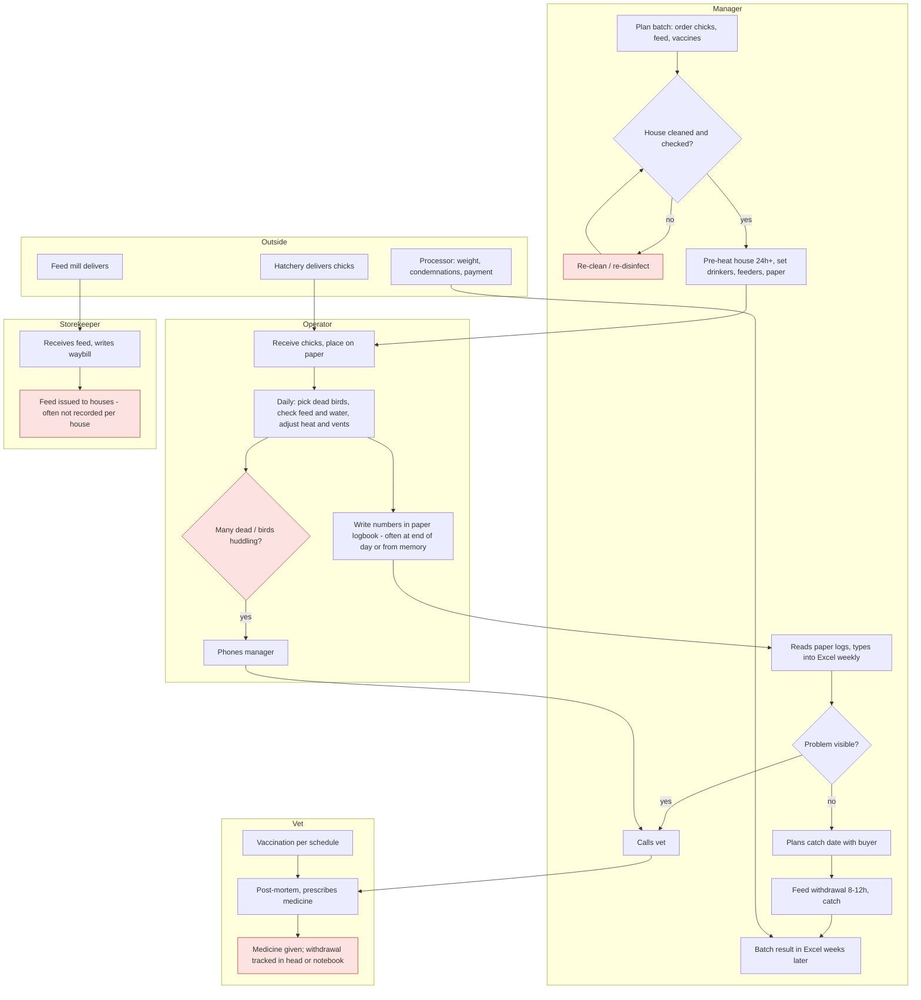
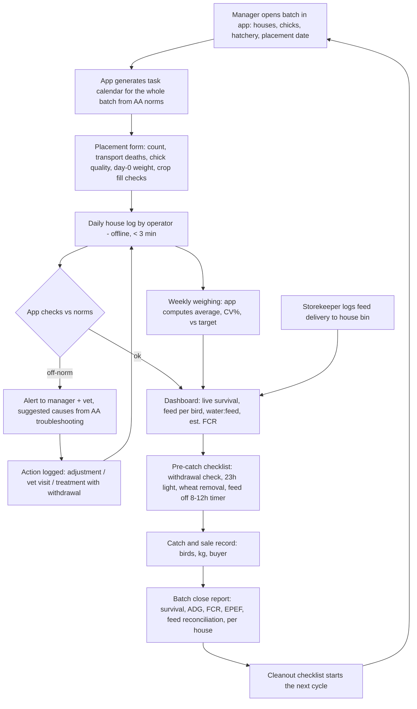
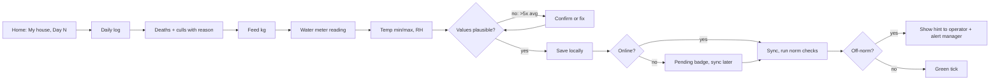
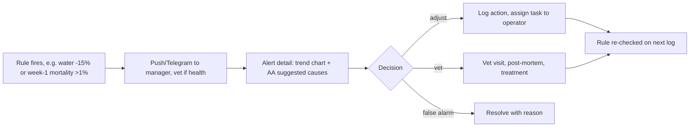
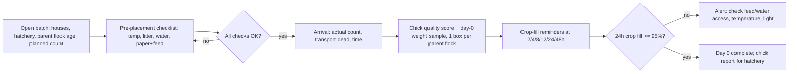
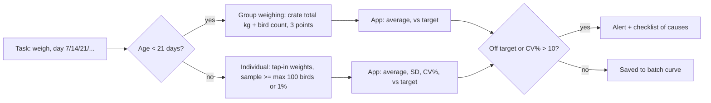
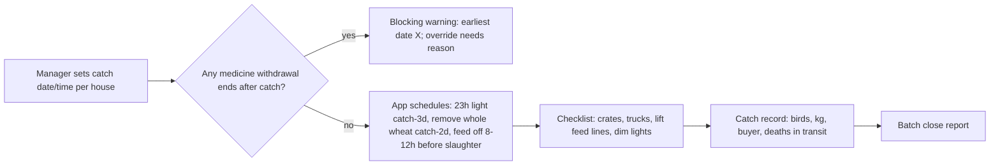
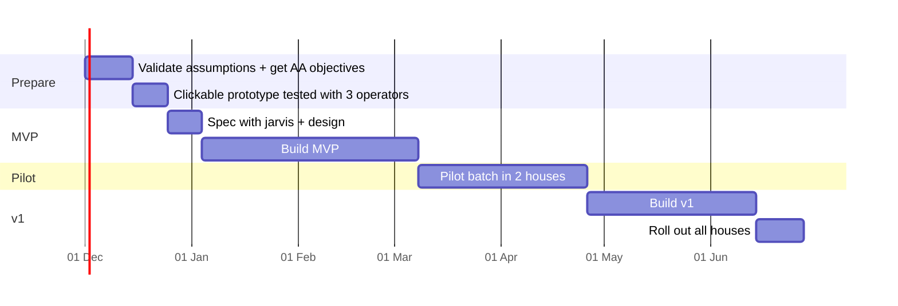

# Broiler Farm App — Product Blueprint
2026-11-24 · v1 · status: **draft**. It is built on assumptions about the farm (marked ⚠️); validate them before the build.
Knowledge base: `knowledge/` (Arbor Acres Handbook 2015 + Russian broiler guide).

---

## 0. Summary

| | |
|---|---|
| **What it is** | A mobile-first, offline-capable app for running broiler batches: house workers log the daily data in under 3 minutes, the app checks it against Arbor Acres norms, and the manager and owner see problems the same day. |
| **Core loop** | Batch opened at placement → daily house log (deaths, feed, water, climate) → norms check and alerts → weekly weighing → pre-catch → batch closed with KPIs (survival, FCR, EPEF). |
| **North Star** | **EPEF per closed batch** (combines survival, weight, age and FCR). ⚠️ Baseline ~280 → target ≥ 320 within 3 batches. |
| **Input metric** | % of house-days with a complete daily log (target ≥ 95%). |
| **MVP in** | Batches and houses, placement record, daily log, auto task calendar from the placement date, norms and alerts, weekly weighing with CV%, medication and vaccination log with withdrawal check, feed deliveries, batch close report, manager and owner dashboard. |
| **MVP out** | Sales and invoicing, accounting/1C integration, IoT sensor integration, payroll, full warehouse, multi-farm. |
| **Biggest risk** | Workers stop entering data after 2 weeks, so the dashboard is empty. **Test:** run a 2-house pilot for one full batch with a paper-replacing form, and track daily completeness. |
| **Missing input** | Arbor Acres **Performance Objectives** (target weight, feed and FCR by day). Without them the app has no "actual vs target" for weight. |

---

## 1. Domain & workflow (as-is)

### 1.1 Assumed farm profile ⚠️
| Item | Assumption |
|---|---|
| Location / climate | Central Asia (assumed Kyrgyzstan): cold winters (heating cost), hot summers (heat stress) |
| Breed | Arbor Acres broilers, mixed sex |
| Houses | 6 closed houses, ~1,200 m² each, nipple drinkers, pan feeders, gas or coal heaters, minimum-ventilation fans, no climate computer in most houses |
| Flock | ~18,000–20,000 birds/house → **~115,000 birds/batch** |
| Cycle | grow 38–42 days (2.3–2.6 kg) + 14–18 days cleanout → **~6 batches/year** |
| Feed | bought pelleted feed (starter/grower/finisher) from a feed mill, delivered in bulk to house bins or in bags |
| Chicks | from 1–2 hatcheries; parent-flock age varies |
| Sales | live birds sold by weight to a processor and wholesale buyers; part on credit |
| Records today | paper logbook in each house → manager re-types into Excel; photos and messages in WhatsApp/Telegram; accountant in 1C or Excel |
| Devices | workers have low/mid-range Android phones; mobile signal weak inside houses; Wi-Fi in the office only |
| Languages | Russian (all), Kyrgyz (some workers) |

### 1.2 Actors
| Role | Inside / outside | Uses app? | Count ⚠️ |
|---|---|---|---|
| House operator (птичница/оператор) | inside | **Yes — main data source** | 6–8 |
| Farm manager / zootechnician (зоотехник) | inside | **Yes — main decision maker** | 1 |
| Veterinarian (ветврач) | inside or contracted | Yes | 1 |
| Storekeeper / feed receiver (кладовщик) | inside | Yes (feed deliveries) | 1 |
| Owner / director | inside | Yes (read-only dashboard) | 1 |
| Accountant / sales | inside | Later (v2) | 1 |
| Hatchery | outside | No — receives a chick-quality report | 1–2 |
| Feed mill | outside | No — receives a feed-quality complaint | 1 |
| Processor / buyers | outside | No — supplies slaughter results | 1–3 |
| Catching crew, drivers | outside | No | crew |

### 1.3 Current workflow (one batch)

**Steps and exceptions**
1. **Cleanout (санразрыв):** remove litter, wash, disinfect, check the water line, rodent control. *Exception:* failed swab, house not ready, placement delayed.
2. **Pre-placement:** heat for ≥ 24 h to air 30 °C and floor 28–30 °C; litter 5–10 cm; flush the water lines; paper covering ≥ 80% of the brooder area with 40 g feed per bird.
3. **Placement (посадка):** count chicks and note parent-flock age and chick quality. *Exception:* poor chicks, count short, transport deaths. Today there is no evidence for a claim against the hatchery.
4. **First week:** crop fill at 2/4/8/12/24/48 h; temperature by behaviour; target mortality < 0.7% and weight at day 7 ≥ 4× day-old weight. *Exception:* week-1 mortality > 1%.
5. **Grow-out (days 7–40):** daily deaths and culls, feed, water, climate, light program; weekly weighing; vaccinations; feed phase changes (starter → grower ~day 10–14 → finisher ~day 25). *Exceptions:* disease outbreak, heat wave, power or water failure, feed bin empty, wet litter.
6. **Pre-catch:** 23 h light for the last 3 days; whole wheat removed 2 days before; medicine withdrawal periods respected; feed withdrawal 8–12 h. *Exception:* buyer changes the date, which can fall inside a withdrawal period.
7. **Catch and sale:** count birds, weigh, transport. *Exception:* weight dispute, processor condemnations.
8. **Batch close:** reconcile feed, chicks and birds sold; calculate FCR and profit. *Today:* done late in Excel, if at all.

### 1.4 Information inventory
| Step | Data / document | Created by | Used by | Today's form | Frequency |
|---|---|---|---|---|---|
| Placement | chick count, hatchery, parent-flock age, arrival time, transport deaths, chick quality, day-0 weight, crop fill % | operator, manager | manager, hatchery | paper / not recorded | per batch |
| Daily | dead and culled birds (+ reason), feed given, water meter reading, t min/max, RH, light hours, notes | operator | manager, vet | paper logbook | daily per house |
| Weekly | sample weights → average, CV% | operator + manager | manager, owner | paper → Excel | weekly |
| Health | vaccine (type, batch no., date, method), medicine (dose, batch no., withdrawal), post-mortem findings | vet | manager, processor | vet notebook | as needed |
| Feed | delivery date, type, tonnes, waybill, quality check | storekeeper | manager, accountant | waybill paper / 1C | 2–3 per week |
| Air | NH3, CO2 (if a meter exists) | manager | manager | rarely recorded | weekly |
| Cleanout | checklist, swab results | manager | manager, vet | not recorded | per batch |
| Visitors | name, company, purpose, previous farm visit | guard | vet | notebook / none | daily |
| Catch / sale | birds caught, live weight, buyer, price, condemnations | manager, accountant | owner | waybills, Excel | per batch |

### 1.5 Pain points ⚠️ costs are estimates for ~115,000 birds per batch
| # | Step | Problem | Cost | Who feels it |
|---|---|---|---|---|
| P1 | Grow-out | Problems are found late: water drop, temperature and early deaths are not seen as a trend | 1% extra mortality ≈ **1,150 birds ≈ 2.9 t live weight per batch** | owner, manager |
| P2 | Grow-out | FCR is unknown until the batch ends; feed is not tracked per house | every +0.1 FCR ≈ **~28 t extra feed per batch** | owner |
| P3 | Feed | Deliveries are not reconciled with consumption; losses or theft are invisible | unknown; 2–3% of feed is typical in loose control ⚠️ | owner, storekeeper |
| P4 | Daily | Manager spends time re-typing paper logs; numbers are written from memory | ~1–1.5 h/day of manager time; poor data quality | manager |
| P5 | Placement | No day-0 evidence (count, quality, crop fill), so no claim against the hatchery | lost compensation and week-1 mortality | manager |
| P6 | Health | Withdrawal periods tracked from memory, catch date can fall inside them | regulatory or buyer rejection risk | vet, owner |
| P7 | Batch close | Owner sees batch results weeks later, so cannot compare houses or batches | slow improvement | owner |
| P8 | Routine | Key age-based actions are missed or late (light change, feed phase switch, guard removal, feed withdrawal) | weight and uniformity loss, carcass defects | manager, operator |

### 1.6 Rules & constraints
- **Default norms are Arbor Acres.** They are kept as an editable reference table per farm (see `knowledge/00_INDEX.md` for the differences from the second guide).
- **Withdrawal periods** follow the drug label and local law, and must block or warn on catch planning.
- **Biosecurity:** all-in/all-out per site, a visitor log, a cleanout checklist.
- **Offline:** mobile signal inside houses is unreliable; data must save locally and sync later.
- **Field use:** dusty, sometimes wet hands, low light at night. Data entry must be one-handed with large targets, numeric keypad, no long forms.
- **Language:** Russian at launch; Kyrgyz labels in v1.

### 1.7 Glossary (UI should use these words)
| Russian | Meaning |
|---|---|
| Партия / тур | batch (one flock cycle) |
| Посадка | placement of day-old chicks |
| Птичник | poultry house |
| Падёж / отход | dead birds (mortality) |
| Выбраковка | culls (birds removed alive) |
| Сохранность | survival % |
| Живая масса (ЖМ) | live weight |
| Однородность, CV% | uniformity |
| Кормоконверсия (FCR) | kg feed per kg live weight |
| ИЭП / EPEF | production efficiency index |
| Брудер | brooding area/period |
| Наполнение зоба | crop fill |
| Санразрыв | cleanout / downtime between batches |
| Срок ожидания | medicine withdrawal period |
| Выдержка без корма | feed withdrawal before catch |
| Отлов | catching |
| Старт / рост / финиш | starter / grower / finisher feed |

---

## 2. Users & jobs

| Role | JTBD | Context | Success measure |
|---|---|---|---|
| **House operator** | When I finish the morning and evening rounds, I want to record what I counted in seconds, so that I'm not blamed for numbers and get told what to do today. | Inside the house, Android phone, dirty hands, weak signal, 2–3 min available, low tech comfort. | Daily log done in < 3 min; ≥ 95% of days logged. |
| **Farm manager** | When I start the day, I want to see which houses are off-norm and why, so that I can act before birds die. | Office or walking between houses; phone, sometimes a laptop. | Problems seen the same day; no Excel re-typing; tasks done on schedule. |
| **Vet** | When birds get sick or a vaccination is due, I want to log the treatment with withdrawal dates and see mortality trends, so that I treat early and never ship birds inside withdrawal. | Moves between houses; phone. | 0 shipments inside withdrawal; treatment starts ≤ 24 h after an alert. |
| **Storekeeper** | When feed arrives or goes to a house, I want to record it against the house and batch, so that feed stock and FCR add up. | Feed area, phone. | Delivery = issue + stock (variance < 1%). |
| **Owner** | When I check the farm (often remotely), I want 3–5 numbers per batch and house plus a batch report, so that I know if the farm is improving and where money is lost. | Phone, anywhere, a few minutes. | EPEF and FCR trend per batch; can compare houses. |

---

## 3. To-be workflow

| Step | Change |
|---|---|
| Typing paper into Excel | **removed** |
| KPI calculation (survival, FCR, CV%, EPEF, density) | **automated** |
| Age-based routine (feed phases, light, weighing days, feed withdrawal) | **automated as a task calendar** |
| Off-norm detection (water, mortality, temperature, CV) | **made visible the same day** |
| Withdrawal-period check vs catch date | **automated (blocking warning)** |
| Feed delivered vs consumed | **made visible** |
| Physical work (heating, vent adjustment, post-mortems) | **stays offline on purpose**; the app only records the result |

**Value proposition:** *Every house's daily numbers checked against Arbor Acres norms the same day, and every batch closed with true FCR and EPEF, without paper or Excel.*

---

## 4. User experience

### 4.1 Key journeys

**Operator: daily log (happy path)**
1. Opens the app (it is already on "My house – Day 23").
2. Sees today's tasks (e.g. "Weigh 100 birds", "Raise drinkers").
3. Taps **Daily log** and fills it in:
   - deaths, with a stepper
   - culls, with a reason chip
   - feed given (kg, or bags × bag weight)
   - water meter reading (the app calculates litres)
   - temperature min/max and RH
4. Saves the log. The app shows a green tick, or a yellow/red hint such as "Water down 18% vs yesterday – check drinkers, tell manager".

**Operator: unhappy paths**
- **No signal:** the log saves locally, a "pending sync" badge shows, and it syncs automatically.
- **Forgot yesterday:** they can back-fill up to 48 h. The entry is flagged "late", and the manager sees it.
- **Typo** (e.g. 900 deaths instead of 9): a soft confirmation appears when a value is more than 5× the 7-day average.
- **Water meter reset or replaced:** a "new meter" option sets the starting reading.

**Manager: morning review**
1. Opens the dashboard: a farm-wide card per house shows a status colour, day of age, survival, and the alerts count.
2. Taps the red house and sees the trend charts (mortality, water, feed per bird, temperature vs target), with an alert explanation and suggested causes (from AA Appendix 5).
3. Assigns an action ("Vet check", "Adjust vents") or resolves the alert with a note.
- **Unhappy path:** a house has no log by 11:00, so the app flags "missing log" and shows the operator's name.

**Vet: treatment**
1. Opens the alert or the house.
2. Records the post-mortem finding (pick list plus a photo).
3. Prescribes the medicine: name, dose, days, batch no., and withdrawal days. The app calculates the earliest catch date.
4. The operator receives "Give medicine X in water, days 24–28" as tasks.
- **Unhappy path:** if the planned catch date is inside the withdrawal period, the catch plan shows a red block, and an override needs an owner's or vet's reason.

**Manager: batch close**
1. The pre-catch checklist completes.
2. Catch records are entered per house (birds, kg, buyer).
3. The app computes the close report and asks to reconcile: chicks placed − dead − culled − caught = **unexplained difference**, and feed delivered − feed in bins = consumed.
4. The report is locked, exported to PDF/Excel, and sent to the owner.

**Owner:** a weekly push or Telegram summary, with one tap to the report.

### 4.2 User flows

**F1 — Daily house log**

**F2 — Alert → action**

**F3 — Placement day**

**F4 — Weekly weighing**

**F5 — Pre-catch & withdrawal**

### 4.3 Navigation & home screen per role
| Role | Tabs | Home screen |
|---|---|---|
| Operator | **Today** · Log · My house · Help | Today: my house, day of age, task list, big "Daily log" button, sync status |
| Manager | **Farm** · Alerts · Tasks · Batches · Reference | Farm: one card per house (status colour, age, survival %, feed per bird, open alerts); missing logs on top |
| Vet | **Health** · Alerts · Treatments · Houses | Health: mortality trend per house, active treatments with withdrawal end dates, due vaccinations |
| Storekeeper | **Feed** · Deliveries · Stock | Feed: bin stock per house in days remaining, "Record delivery" button |
| Owner | **Overview** · Batches · Reports | Overview: current batch (survival, avg weight vs target, est. FCR), last 3 batches EPEF/FCR, alerts count |

### 4.4 Screen inventory
| Screen | Role | Purpose | Key data | Key actions | Release |
|---|---|---|---|---|---|
| Login / pick house | all | sign-in by phone + PIN | user, assigned houses | log in | MVP |
| Today | operator | what to do now | day of age, tasks, last log status | open log, tick task | MVP |
| Daily log | operator | record the day | deaths, culls+reason, feed, water meter, t min/max, RH, note, photo | save, back-fill ≤ 48 h | MVP |
| Weighing | operator, manager | sample weights | group/individual entries, avg, SD, CV% | add weights, finish | MVP |
| Placement | manager | open house in batch | hatchery, parent flock age, count, transport dead, quality, day-0 weight, crop fill | save, generate chick report | MVP |
| Farm overview | manager | all houses at a glance | status per house | drill into house | MVP |
| House detail | manager, vet | trends vs norms | charts: mortality, water, water:feed, feed/bird, temp vs target, weight curve | assign task, open alert | MVP |
| Alerts | manager, vet | act on off-norm | rule, value, norm, trend, suggested causes | assign, resolve | MVP |
| Treatments & vaccinations | vet | health log | product, batch no., dose, method, days, withdrawal | add, schedule tasks | MVP |
| Catch plan & pre-catch | manager | safe catch | catch date, withdrawal check, timers, checklist | plan, override with reason | MVP |
| Batch close report | manager, owner | results | placed, dead, culled, caught, kg, survival, ADG, FCR, adjusted FCR, EPEF, feed reconciliation, per house | lock, export PDF/XLSX | MVP |
| Feed deliveries | storekeeper | feed in | date, supplier, type, tonnes, waybill photo, house/bin | record | MVP |
| Owner overview | owner | headline numbers | current batch + last batches | open report | MVP |
| Reference norms | manager | AA targets | temp by age and RH, light, density, equipment ratios, weight targets | edit per farm | MVP (seeded, edit = v1) |
| Cleanout checklist | manager | prepare house | 18-step list, swab results, photos | tick, attach | v1 |
| Visitor log | guard/manager | biosecurity | name, company, purpose, last farm visit | add | v1 |
| Feed stock & reconciliation | storekeeper, manager | find losses | delivered vs consumed vs bin | adjust with reason | v1 |
| Slaughter results | manager | close loop | condemnations by type, carcass yield | enter/import | v1 |
| Batch comparison | owner, manager | learn | EPEF, FCR, survival by house/batch/hatchery/season | filter | v1 |
| Sales & payments | accountant | money | buyer, kg, price, paid, debt | invoice, record payment | v2 |
| Costs & P&L per batch | owner, accountant | profit | chicks, feed, meds, energy, labour, revenue | — | v2 |
| Ventilation helper | manager | settings | min vent per bird by weight (App. 6), timer % and seconds | calculate | v1 |
| Users & houses admin | manager | setup | users, roles, houses (area, equipment) | add/edit | MVP (basic) |

### 4.5 Cross-cutting UX

**Alert rules (MVP)** come from the knowledge base. Thresholds marked ⚠️ are assumed, so farms can tune them.
| Rule | Trigger | To |
|---|---|---|
| Week-1 mortality | cumulative > 0.7% → warning; > 1% → alert | manager, vet |
| Daily mortality spike | today > 2× the 3-day average and > 0.05% of birds ⚠️ | manager, vet |
| Water change | daily litres ±15% vs previous day ⚠️ | manager |
| Water:feed ratio | outside 1.6–1.8 (nipples) adjusted +6.5%/°C above 21 °C | manager |
| Temperature | outside the age target (AA Table 2) ± 1.5 °C ⚠️ | manager |
| Humidity | < 50% before day 10; > 70% after day 18 | manager |
| Crop fill | < 95% at 24 h | manager |
| Day-7 weight | < 4× day-0 weight | manager |
| Uniformity | CV% > 10 | manager |
| Density | projected kg/m² at catch > the farm limit (e.g. 39) | manager |
| Withdrawal | catch date < withdrawal end | manager, vet (blocking) |
| Missing log | no daily log by 11:00 ⚠️ | manager |
| Feed bin | < 2 days of feed left | storekeeper, manager |

**Channels:** in-app inbox plus push; a Telegram bot for the manager, vet and owner (fits existing habits). Quiet hours do not apply to red alerts.

**Permissions matrix**
| Action | Operator | Manager | Vet | Storekeeper | Owner |
|---|---|---|---|---|---|
| Daily log (own house) | create/edit ≤ 48 h | edit any | view | — | view |
| Weighing | create | create/edit | view | — | view |
| Placement / batch open/close | — | full | view | — | view |
| Treatments / vaccinations | view tasks | view | full | — | view |
| Catch plan, override withdrawal | — | plan | override | — | override |
| Feed deliveries | — | view/edit | — | full | view |
| Norms reference, users | — | full | — | — | view |
| Reports export | — | yes | yes | — | yes |

**Offline:** all operator screens work offline with a local queue; norm checks run on the device too, so hints appear immediately; conflicts resolve as last write wins plus an audit log.
**States:** empty state on a new batch ("Placement not recorded yet — start here"); errors in plain words; sync badge on every record.
**UI language:** Russian at MVP; Kyrgyz in v1; all labels in a translation file.
**Field use:**
- touch targets ≥ 48 px, numeric keypad, steppers for counts
- high-contrast theme readable in a dim house
- ≤ 6 fields per log screen
- voice note and photo as optional proof

---

## 5. Roadmap

### 5.1 Prioritization (RICE-lite: R×I×C÷E, each 1–5)
| Feature | R | I | C | E | Score | MoSCoW | Note |
|---|---|---|---|---|---|---|---|
| Daily house log (offline) | 5 | 5 | 5 | 3 | 41.7 | Must | enabler of everything |
| Norm checks + alerts | 4 | 5 | 4 | 3 | 26.7 | Must | P1 |
| Batch KPIs + close report | 4 | 5 | 5 | 2 | 50 | Must | P2, P7 |
| Auto task calendar | 5 | 4 | 4 | 2 | 40 | Must | P8 |
| Placement record + chick report | 3 | 4 | 4 | 2 | 24 | Must | P5 |
| Weekly weighing + CV% | 4 | 4 | 5 | 2 | 40 | Must | uniformity |
| Treatments + withdrawal check | 3 | 5 | 5 | 2 | 37.5 | Must | P6 |
| Feed deliveries per house | 3 | 4 | 4 | 2 | 24 | Must | enabler for FCR |
| Owner overview + Telegram summary | 2 | 4 | 4 | 1 | 32 | Should | |
| Feed stock reconciliation | 3 | 4 | 3 | 3 | 12 | Should | P3 |
| Cleanout checklist | 3 | 3 | 4 | 2 | 18 | Should | |
| Visitor log | 2 | 2 | 4 | 1 | 16 | Should | biosecurity |
| Batch comparison analytics | 2 | 4 | 3 | 3 | 8 | Should | |
| Slaughter results | 2 | 3 | 3 | 2 | 9 | Should | |
| Ventilation helper | 2 | 3 | 3 | 1 | 18 | Could | |
| Sales, payments, debts | 2 | 4 | 3 | 4 | 6 | Could | v2 |
| Batch P&L | 2 | 5 | 3 | 4 | 7.5 | Could | v2 |
| Sensor/controller integration | 3 | 4 | 2 | 5 | 4.8 | Could | v2 |
| 1C integration | 1 | 3 | 2 | 4 | 1.5 | Won't (now) | export XLSX instead |

### 5.2 Releases
| Release | Goal | Epics | Exit criterion | Depends on | Size ⚠️ (2 devs + PM part-time) |
|---|---|---|---|---|---|
| **MVP** | One full batch run in the app, no paper | Batches & houses · Placement · Daily log (offline) · Task calendar · Norms & alerts · Weighing · Health log + withdrawal · Feed deliveries · Close report · Manager/owner dashboard · Basic admin | 2 pilot houses: ≥ 95% complete daily logs for a whole batch; close report matches manual check within 1% | AA Performance Objectives; seeded norms | L · ~8–10 weeks build |
| **Pilot** | Prove adoption and accuracy | — (run, fix, measure) | Operators < 3 min/log; manager stops Excel; alerts judged useful ≥ 70% | MVP | 1 batch · ~6–8 weeks |
| **v1** | Whole farm, close the money leaks | All houses · Feed stock reconciliation · Cleanout checklist · Visitor log · Slaughter results · Batch comparison · Kyrgyz UI · Norms editing · Ventilation helper | EPEF +5–10% vs baseline over 2 batches; feed variance < 1% | Pilot results | M · ~6–8 weeks |
| **v2** | Money and automation | Sales, payments & debts · Batch P&L · Controller/sensor import (temperature, water) · Multi-site | Batch profit known within 3 days of catch | v1, sensor vendor | L |

### 5.3 Out of MVP, and why
- **Sales and invoicing:** not in the production loop; the accountant's current tools still work.
- **1C or accounting integration:** costly and fragile; an XLSX export covers it first.
- **IoT/climate computer integration:** most houses have none ⚠️; manual min/max entry first.
- **Payroll and HR, full warehouse:** not linked to the costed pains.
- **Multi-farm:** one site first.

### 5.4 Timeline (relative; assumes start in week 1)

### 5.5 Metrics per release
| Metric | Baseline ⚠️ | MVP/Pilot target | v1 target |
|---|---|---|---|
| Daily log completeness | 0 (paper) | ≥ 95% | ≥ 98% |
| Time per daily log | — | < 3 min | < 2 min |
| Manager time on records | ~1–1.5 h/day | < 20 min/day | < 15 min/day |
| Time from problem to alert | 1–3 days | same day | same day |
| Survival % | ~93–94% | measure | ≥ 95% |
| FCR (≈ 2.4 kg) | ~1.80–1.85 | measure | −0.05 |
| EPEF | ~280 | measure | ≥ 320 |
| Shipments inside withdrawal | unknown | 0 | 0 |
| Feed variance (delivered vs consumed) | unknown | measure | < 1% |

### 5.6 Risks & assumptions
| Item | Impact if wrong | Cheapest test | Before |
|---|---|---|---|
| Operators will log on phones daily | dashboard is empty, project fails | 2-week paper-form → Google Form or Telegram-bot trial with 2 operators | MVP spec |
| Operators have Android phones | need farm-owned devices | count phones; budget 6–8 cheap tablets or phones | MVP |
| No signal in houses | sync issues | walk test; offline-first is required anyway | MVP |
| AA Performance Objectives available | no weight-vs-target | ask the Aviagen rep or download from Aviagen | MVP spec |
| Water meter on each house | lose the best early-warning signal | check the houses; install meters (low cost) | pilot |
| Feed is tracked per house | FCR per house is impossible | ask the storekeeper how feed reaches houses; weigh or count bags | pilot |
| Farm size and setup (6 × 20k) | screens and limits off | answer the 5 open questions | spec |
| Alert thresholds are right | alert fatigue | tune during the pilot; target ≥ 70% "useful" | v1 |
| Owner enforces the "not in app = not done" rule | parallel paper continues | owner commitment at kickoff | pilot |

### 5.7 Build vs buy
Off-the-shelf broiler management software exists: international platforms, plus ERP/1C-based agricultural configurations in the CIS market. Availability, language and pricing in the region need checking. **Recommendation:** a 1–2 week evaluation against this must-have checklist before committing to a build:
- Russian (+ Kyrgyz) UI
- offline mobile data entry for operators
- Arbor Acres norms and editable alert rules
- withdrawal-period check
- per-house feed and water tracking
- batch close with FCR and EPEF
- Telegram/push alerts
- affordable price for 6 houses
- XLSX export

A custom build is justified if no tool meets the offline + local-language + price requirements, or if the app is meant to serve several farms in the region later (a product opportunity).

### 5.8 Adoption plan
1. **Champion:** the farm manager owns the rollout; the owner announces that from the pilot start, *"if it's not in the app, it didn't happen"* for logs and treatments.
2. **Pilot:** the 2 most reliable operators, 1 batch; the paper logbook runs in parallel for the first 7 days only, then is removed.
3. **Training:** a 30-minute hands-on session in the house plus a 1-page picture guide in Russian/Kyrgyz; a "Help" tab with short videos.
4. **Incentive ⚠️:** a small monthly bonus for ≥ 95% complete logs, and recognition of the best house by EPEF.
5. **Old data:** import the last 2–3 batches' totals from Excel as a baseline (optional).
6. **Feedback loop:** a weekly 15-minute review with operators during the pilot; fix friction within a week.

---

## 6. Handoff brief for jarvis

**Product goal:** offline-first mobile app (plus a web dashboard) for a ~6-house broiler farm. It digitizes the daily house log, checks it against editable Arbor Acres norms, raises alerts, and closes each batch with FCR and EPEF.

**Roles:** Operator, Manager, Vet, Storekeeper, Owner (permissions matrix in §4.5).

**MVP epics → user stories**
1. **Setup:** As a manager, I want to define houses (area m², drinker/feeder type, water meter) and users with roles, so the app knows the farm.
2. **Batch & placement:**
   - As a manager, I want to open a batch with houses, hatchery, parent-flock age and chick count, so all records attach to it.
   - As a manager, I want to record arrival (count, transport deaths, quality score, day-0 sample weights, crop fill at 2/4/8/12/24/48 h), so I have evidence for the hatchery.
3. **Task calendar:** As an operator, I want age-based tasks generated from the placement date (feed phases, light changes, weighing days, guard removal, pre-catch steps), so nothing is missed.
4. **Daily log:** As an operator, I want to enter the following offline in < 3 min, so my house's day is recorded:
   - deaths
   - culls with reason
   - feed kg
   - water meter reading
   - t min/max and RH
   - a note and photo
5. **Norms & alerts:**
   - As a manager, I want each log checked against norm tables and rules (§4.5), so I get alerts with suggested causes.
   - As a manager, I want to resolve or assign alerts.
6. **Weighing:** As an operator, I want group (crate) or individual weighing with an automatic average, SD and CV%, compared with the target weight for that age.
7. **Health:** As a vet, I want to log vaccinations and treatments (product, batch no., dose, method, days, withdrawal days), generating operator tasks and a withdrawal end date.
8. **Feed deliveries:** As a storekeeper, I want to record deliveries (supplier, type, tonnes, waybill photo) against a house or bin.
9. **Catch & close:**
   - As a manager, I want to plan the catch with a blocking withdrawal check and a feed-withdrawal timer.
   - As a manager, I want to record catch per house (birds, kg, buyer) and get a locked close report (survival, ADG, FCR, adjusted FCR, EPEF, bird and feed reconciliation), with PDF/XLSX export.
10. **Dashboards & notifications:** farm overview for the manager, health view for the vet, overview for the owner; push plus a Telegram bot for alerts and a weekly summary.

**Core data entities**
- Farm, House (area, equipment, meter), User/Role
- Batch, HouseBatch (placement: hatchery, parent-flock age, count, quality), DailyLog, CullReason
- Weighing (type, sample entries), Task (template rule + instance), NormTable (temperature by age and RH, weight target by day, light, density, ratios), AlertRule, Alert, Action
- Vaccination, Treatment (withdrawal days → end date), Product
- FeedDelivery, FeedType, CatchRecord, Buyer, BatchReport, AuditLog

**KPI formulas** (in `knowledge/04_AA_appendices_records_kpi.md`):
- survival % = (placed − dead − culled) / placed
- FCR = feed / total live kg
- adjusted FCR = FCR + (target − actual kg)/4.5
- EPEF = survival% × kg / (age × FCR) × 100
- CV% = SD / mean × 100
- density = birds × kg / m²
- water:feed ratio
- effective temperature = min + 2/3 × (max − min)

**Seed data:** AA temperature Tables 2–3, crop-fill Table 4, light program, feed phases and forms, equipment ratios, min-ventilation table, troubleshooting Appendix 5. Weight/feed targets by day come from the AA Performance Objectives (to obtain).

**Integrations:** Telegram Bot API (notifications); XLSX/PDF export. No 1C or sensors in MVP.

**Non-functional:**
- offline-first on Android 8+ low-end devices
- sync on reconnect, audit log of all edits
- Russian UI at MVP, i18n-ready for Kyrgyz
- ~10 users, ~6 houses, ~6 batches/year
- data retention ≥ 5 years
- the norm-check engine runs on the device and the server

**Open questions**
1. Farm size, houses and equipment (confirm §1.1).
2. Phones vs farm-owned devices.
3. How feed reaches each house today.
4. Water meters present?
5. Buyer and processor data available after catch?
6. Has build vs buy been decided?
7. Has Aviagen Performance Objectives been obtained?
8. Is a climate controller present in any house?

> **Next step:** give this to jarvis to turn the MVP into a technical spec and dev tickets.
