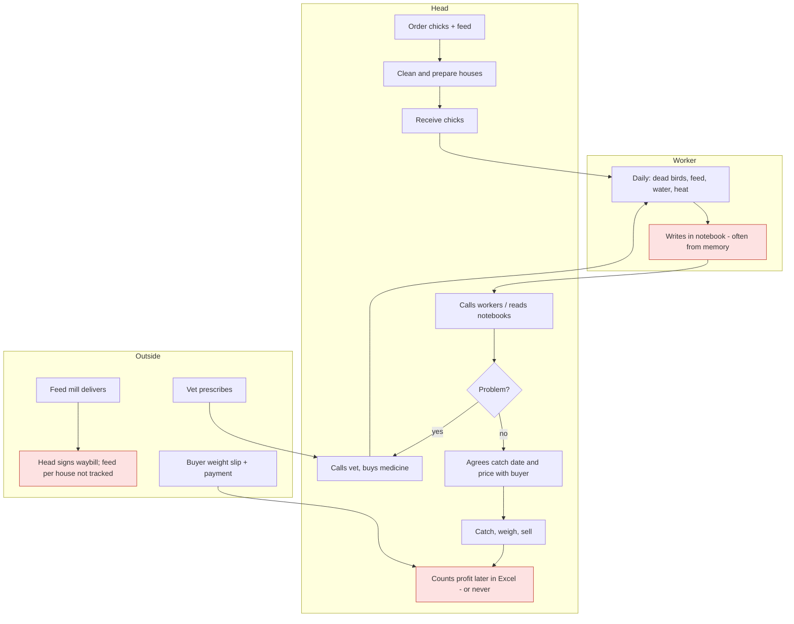
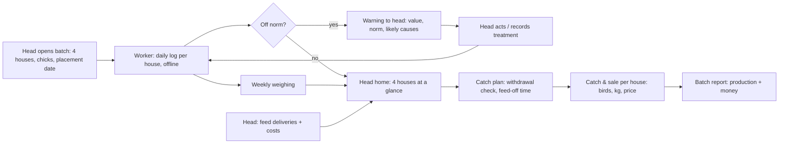
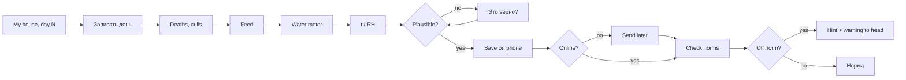
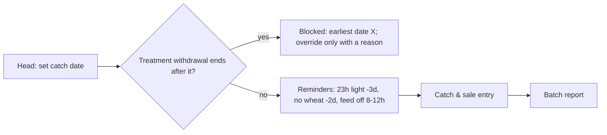

# Broiler Farm App — Product Blueprint
2026-11-24 · **v2** (rewritten for a mid-size farm; v1 is in `archive/v1/`) · status: draft
Knowledge base: `knowledge/` (Arbor Acres Handbook 2015 + Russian broiler guide).

**Confirmed by you:**
- 3–4 houses, 40–80k birds
- two roles: head + house workers
- workers use their own Android phones
- the first version covers daily records, early warnings, batch results and money

Everything else marked ⚠️ is an assumption.

---

## 0. Summary

| | |
|---|---|
| **What it is** | A simple app for one broiler farm: workers log each house daily on their phones; the head sees problems the same day and gets a full batch result, including profit, without Excel. |
| **Core loop** | Open batch → daily house log → warning if off-norm → weekly weight → catch & sale → **batch report: production + money** |
| **North Star** | **EPEF per batch** ⚠️ baseline ~280 → target ≥ 310 in 3 batches |
| **Owner's number** | **Profit per kg live weight** per batch |
| **Input metric** | ≥ 95% of house-days logged |
| **MVP in** | daily log · weekly weighing · 8 warnings · feed deliveries · treatments with withdrawal check · catch & sale · costs · batch report |
| **MVP out** | warehouse, payroll, 1C, sensors, multi-site, task calendar beyond key dates, approvals |
| **Biggest risk** | workers stop logging. **Test:** 1 house, 2 weeks, before the build |

### 0.1 The farm we design for ⚠️
| Item | Assumption |
|---|---|
| Houses | **4 houses × ~17,000 birds ≈ 68,000 per batch**, ~1,000 m² each |
| Breed / system | Arbor Acres, mixed sex, floor litter, nipple drinkers, pan or chain feeders, heaters, simple fans |
| Batch | all-in/all-out: all houses placed within 1–2 days, whole house caught at once; grow 40–42 days + 14–18 days cleanout ≈ **6 batches/year** |
| Team | **Head** (owner who also manages and does the zootechnics, 1 person) + **2–4 house workers** (1 per house or 1 per 2 houses) + contracted vet (not an app user) + hired catching crew |
| Feed | bought pelleted (starter/grower/finisher), delivered straight into house bins or in bags; the head receives it |
| Sales | live birds by weight to 1–3 buyers (processor, wholesalers), some on credit |
| Today | paper notebook per house, numbers phoned in or sent on WhatsApp/Telegram, head's Excel or notebook |
| Devices | workers' own Android phones; weak signal inside houses; head has a phone + laptop |
| Language | Russian (Kyrgyz later) |

---

## 1. Domain & workflow (as-is)

### 1.1 Actors
| Role | Inside / outside | Uses app? | Count |
|---|---|---|---|
| **Head** (owner-manager) | inside | **Yes**: everything except daily house entries | 1 |
| **House worker** | inside | **Yes**: daily log, weighing, tasks for their house(s) | 2–4 |
| Vet (contracted) | outside | No: tells the head what to give; the head records it | 1 |
| Hatchery, feed mill | outside | No | 1–2 each |
| Buyers | outside | No: their weight slip is entered by the head | 1–3 |
| Catching crew | outside | No | crew |

### 1.2 Current workflow (one batch)

**Exceptions that matter**
- deaths spike
- water drops
- a bin runs empty
- a catch date clashes with medicine withdrawal
- the buyer's weight slip doesn't match
- a worker is absent

### 1.3 Information inventory
| Data | Created by | Used by | Today | Frequency |
|---|---|---|---|---|
| Placement: chicks, hatchery, parent-flock age, transport deaths, day-0 weight | head | head, hatchery | paper / none | per batch |
| Daily: deaths, culls, feed, water meter, t min/max, RH | worker | head | notebook | daily × 4 |
| Weekly weight (sample) | worker / head | head | rarely | weekly |
| Feed delivery: date, type, tonnes, house, price | head | head | waybills | 1–2/week |
| Treatment / vaccine: product, dose, days, withdrawal | head (from vet) | head | memory | as needed |
| Catch & sale: birds, kg, buyer, price, paid | head | head | slips, notebook | per batch |
| Other costs: chicks, litter, gas/coal, electricity, labour, vet | head | head | notebook | per batch |

### 1.4 Pain points (68k birds) ⚠️ estimates
| # | Problem | Cost per batch |
|---|---|---|
| P1 | Problems seen 1–3 days late | +1% mortality ≈ **680 birds ≈ 1.7 t live weight** |
| P2 | No FCR until the end, feed not tracked per house | +0.1 FCR ≈ **~17 t feed** |
| P3 | Profit per batch unknown or weeks late | can't tell a good batch from a bad one |
| P4 | Head phones around and re-types numbers | ~1 h/day |
| P5 | Withdrawal tracked from memory | rejected birds or a fine |
| P6 | Key age steps missed (light, feed phase, feed withdrawal) | weight and uniformity loss |

### 1.5 Rules & constraints
- Norms: **Arbor Acres**, stored as an editable table.
- Withdrawal: per the drug label; it must block a catch date that comes too early.
- Offline: house entries must work with no signal and sync later.
- Field use: one hand, dirty hands, dim light; big buttons, numeric keypad, ≤ 6 fields per screen.
- Russian UI at launch.

### 1.6 Glossary
| Term | Meaning |
|---|---|
| Партия | batch |
| Птичник | house |
| Посадка | placement |
| Падёж / Выбраковка | dead birds / culls |
| Сохранность | survival % |
| Живая масса | live weight |
| Однородность (CV%) | uniformity |
| Кормоконверсия (FCR) | kg feed per kg live weight |
| ИЭП (EPEF) | efficiency index |
| Срок ожидания | withdrawal period |
| Выдержка без корма | feed withdrawal before catch |
| Отлов | catch |
| Санразрыв | cleanout |
| Старт / рост / финиш | feed phases |

---

## 2. Users & jobs

| Role | Job (JTBD) | Context | Success |
|---|---|---|---|
| **House worker** | When I finish my morning round, I want to record the numbers in a minute and see if anything is wrong, so I don't have to call or write. | Inside the house, own phone, no signal, 2 min | log in < 2 min, ≥ 95% of days |
| **Head** | When I start my day, I want to see which house is off and why. When a batch ends, I want to see what I earned and why, so I can act early and improve the next batch. | Phone around the farm, laptop in the evening | problems seen the same day; batch report incl. profit within 2 days of the last sale |

---

## 3. To-be workflow

| Step | Change |
|---|---|
| Notebook → phone log | **removed** paper and re-typing |
| Survival, FCR, EPEF, density, profit | **automated** |
| Off-norm detection | **visible same day** |
| Withdrawal vs catch | **automated block** |
| Key age steps (light, feed phase, weighing, feed-off) | **reminders** |
| Heating, ventilation, vet visits | stay offline; the app records the result only |

**Value proposition:** *every house checked against Arbor Acres norms every day, and every batch closed with real FCR and profit, without paper or Excel.*

---

## 4. User experience

### 4.1 Key journeys

**Worker: daily log (< 2 min)**
1. Opens the app on "My house · day 23".
2. Taps **Записать день** and enters:
   - deaths and culls (+/−)
   - feed (kg, or bags)
   - water meter reading
   - t min/max and RH
3. Saves the log. They see a green "норма" or a hint ("Water −18%: check nipples, the head has been told").

Unhappy paths:
- **No signal:** the log saves on the phone and sends later.
- **Forgot yesterday:** they can still fill it within 48 h.
- **Typing mistake** (e.g. 90 instead of 9): the app asks "Это верно?".

**Head: morning**
1. Opens Ферма: 4 house rows, each with a status, day of age, survival, today's deaths, water:feed and feed days left.
2. Taps a red house to see the trends against the norm, the warning and its likely causes.
3. Notes the action taken, or records a treatment. Treatment days appear as tasks for the worker.

Unhappy path: a house has no log by 11:00, so the app shows "нет журнала" with the worker's name and a call button.

**Head: end of batch**
1. Sets the catch date per house. The app checks it against withdrawal and shows when to remove feed.
2. After the catch, enters the buyer slip: birds, kg, price, paid / owed.
3. The batch report opens: production (survival, weight, FCR, EPEF) + money (costs by category, revenue, profit per kg and per bird) + bird and feed reconciliation.
4. Closes the batch, and the report locks.

### 4.2 User flows

### 4.3 Navigation
| Role | Tabs | Home screen |
|---|---|---|
| Worker | **Сегодня** · Журнал · Взвешивание | my house(s), day of age, today's 2–3 tasks, a big "Записать день" button, sync status |
| Head (phone and laptop, same app, responsive) | **Ферма** · Партия · Корм и затраты · Отчёты · Настройки | Ферма: 4 house rows + open warnings |

### 4.4 Screens: **11 in total**
| # | Screen | Role | Purpose | Key actions | Release |
|---|---|---|---|---|---|
| 1 | Сегодня | worker | my house today | open log, tick task | MVP |
| 2 | Журнал дня | worker (head can edit) | daily entry + norm check | save, fix ≤ 48 h | MVP |
| 3 | Взвешивание | worker, head | sample → average, CV% | add weight, finish | MVP |
| 4 | Ферма | head | 4 houses + warnings | open house, note action | MVP |
| 5 | Птичник | head | trends vs norm, history, treatments | add treatment, edit log | MVP |
| 6 | Партия: открыть / посадка | head | houses, chicks, hatchery, day-0 data | open batch | MVP |
| 7 | Корм и затраты | head | feed deliveries per house + other costs | add delivery, add cost | MVP |
| 8 | Лечение | head | product, days, withdrawal → earliest slaughter | add | MVP |
| 9 | Отлов и продажа | head | catch plan + buyer slip | set date, enter sale, mark paid | MVP |
| 10 | Отчёт партии | head | production + money + reconciliation | close, export PDF/XLSX | MVP |
| 11 | Настройки | head | houses, workers, norms, thresholds | edit | MVP (basic) |

### 4.5 Cross-cutting rules
- **Notifications:** warnings go to the head by push + Telegram; the worker sees the hint on save. Daily summary for the head at 18:00.
- **Permissions:** the worker sees and edits only their house(s), and logs ≤ 48 h old. The head can do everything; editing an older log needs a reason.
- **Offline:** the worker's screens work fully offline; a visible "не отправлено" counter shows until sync. The head's screens show cached data with "обновлено N мин назад".
- **States:** every list has empty, loading and error states. The worker sees "нет партии" during cleanout.
- **Field use:** touch targets ≥ 48 dp, +/− buttons for counts, numeric keypad, high contrast.

---

## 5. How the app works (logic)

### 5.1 Objects and their states
| Object | States | Rule |
|---|---|---|
| **Batch** | Открыта → Отлов → Закрыта | closing locks the report; the head can reopen it with a reason |
| **House in batch** | Посадка → Выращивание → Отловлен | day of age counted from **this house's** placement date |
| **Daily log** | На телефоне → Отправлен → Закрыт (after 48 h) | one per house per day; an edit recalculates everything after it |
| **Warning** | Открыта → Отмечена (action noted) → Закрыта | one per rule per house per day; closes itself after 24 h back in norm |
| **Treatment** | Курс → Ожидание → Чисто | earliest slaughter = last dose + withdrawal days + 1; blocks catch until then |

### 5.2 Calculations
| Number | How |
|---|---|
| Live birds | placed − Σ deaths − Σ culls |
| Mortality % | daily and cumulative; week 1 shown separately |
| Feed per bird | feed kg / live birds |
| Water | meter today − meter yesterday |
| Water:feed | water L / feed kg; norm 1.6–1.8, +6.5% per °C above 21 °C |
| Working temperature | min + ⅔ × (max − min), against AA Table 2 by age |
| Average weight, CV% | from the weighing sample |
| FCR (running) | Σ feed / (live birds × last weight), marked "оценка" |
| FCR (final) | (feed delivered − feed left) / kg sold |
| EPEF | survival % × kg / (age × FCR) × 100 |
| Density | live birds × weight / m² |
| Feed days left | bin stock / 3-day average use |
| Cost per batch | Σ chicks + feed + medicine + litter + energy + labour + vet + other |
| Revenue | Σ kg sold × price |
| Profit | revenue − costs; also per kg live and per bird placed |
| Bird check | placed − deaths − culls − sold (unexplained if > 0.2%) |
| Feed check | delivered − left − logged (unexplained if > 1%) |

### 5.3 Warnings in MVP: 8 rules, thresholds editable
| Warning | Fires when |
|---|---|
| Week-1 mortality | > 0.7% cumulative by day 7 (critical > 1%) |
| Mortality spike | today > 2× the 3-day average |
| Water change | ±15% vs yesterday |
| Water:feed | outside the adjusted norm |
| Temperature | working t outside AA target ± 1.5 °C |
| Weight / uniformity | weight < −5% of norm*, or CV% > 10 |
| Feed bin | < 2 days left |
| No log | missing by 11:00 |

If two or more fire for one house on the same day, they are shown as one **"Возможна болезнь — позвоните ветврачу"**.
*Weight norm needs the AA Performance Objectives booklet; until then it is a placeholder.

### 5.4 Reminders (created from the placement date)
- **Day 0:** crop fill at 24 h ≥ 95%.
- **Day 7:** weigh, then switch to 4–6 h darkness.
- **~Day 10:** starter → grower.
- **Day 18:** pellets.
- **~Day 25:** finisher.
- **Weekly:** weighing.
- **Before catch:** −3 d 23 h light, −2 d no whole wheat, −8…12 h feed off.

---

## 6. Roadmap

### 6.1 Prioritization (RICE-lite)
| Feature | R | I | C | E | Score | MoSCoW |
|---|---|---|---|---|---|---|
| Daily log (offline) | 5 | 5 | 5 | 3 | 42 | Must (enabler) |
| Farm view + 8 warnings | 4 | 5 | 4 | 3 | 27 | Must |
| Batch report (production) | 3 | 5 | 5 | 2 | 38 | Must |
| Catch & sale + withdrawal check | 3 | 5 | 5 | 2 | 38 | Must |
| Feed deliveries + costs → profit | 3 | 5 | 4 | 2 | 30 | Must |
| Weekly weighing | 4 | 4 | 5 | 2 | 40 | Must |
| Age reminders | 4 | 3 | 4 | 1 | 48 | Should |
| Telegram notifications | 2 | 3 | 4 | 1 | 24 | Should |
| Buyer debts tracking | 1 | 3 | 4 | 1 | 12 | Could (v1) |
| Cleanout checklist | 2 | 3 | 4 | 1 | 24 | Could (v1) |
| Batch-to-batch comparison | 1 | 4 | 4 | 2 | 8 | v1 |
| Sensors, 1C, multi-site | — | — | — | — | — | Won't (now) |

### 6.2 Releases ⚠️ assumes 1–2 developers
| Release | Goal | Content | Exit criterion | Size |
|---|---|---|---|---|
| **Test (before build)** | will workers log daily? | Telegram bot or Google Form, 1 house | ≥ 12 of 14 days logged | 2 weeks |
| **MVP** | one full batch in the app, including profit | screens 1–11, 8 warnings, reminders | 4 houses, ≥ 95% logs for a full batch; report matches a manual check within 1% | ~8 weeks |
| **Pilot batch** | prove it | run, fix, measure | head stops paper/Excel | ~6 weeks |
| **v1** | learn across batches | batch comparison, cleanout checklist, buyer debts, Kyrgyz UI | EPEF ↑ over 2 batches | ~4 weeks |
| **v2** | less typing | climate-controller / water-meter import if the houses have them | — | later |

### 6.3 Out of scope, and why
- **Separate vet and storekeeper roles:** the head does it; add them only if the team grows.
- **Warehouse, payroll, accounting/1C:** not part of the batch loop; an XLSX export covers it.
- **Approvals, audit screens:** one person decides; edits are still logged in the background.
- **Thinning, multi-site, staggered batches:** not how this farm works.

### 6.4 Metrics
| Metric | Baseline ⚠️ | MVP / pilot | v1 |
|---|---|---|---|
| Logged house-days | 0 (paper) | ≥ 95% | ≥ 98% |
| Time per daily log | — | < 2 min | < 2 min |
| Head's time on records | ~1 h/day | < 15 min | < 10 min |
| Survival | ~94% | measure | ≥ 95.5% |
| FCR (~2.4 kg) | ~1.85 | measure | −0.05 |
| EPEF | ~280 | measure | ≥ 310 |
| Report ready after the last sale | weeks | ≤ 2 days | same day |

### 6.5 Risks & assumptions
| Risk | If wrong | Cheapest test |
|---|---|---|
| Workers won't log daily | no data → no value | 2-week Telegram-bot test, 1 house |
| Each house has a water meter | lose the best early signal | check; install (cheap) |
| Feed can be counted per house | no FCR per house | ask how feed reaches each bin |
| AA weight norms available | no weight warning | ask the Aviagen rep / hatchery |
| Head enters costs and sales | no profit | the head enters one past batch in a sheet |

### 6.6 Build vs buy
Ready-made broiler software exists. Check 1–2 products for 1 week against these must-haves:
- Russian UI
- offline worker log on Android
- AA norms
- withdrawal check
- profit per batch
- price that makes sense for 4 houses

Build if none fits. For a farm this size, the most common case is a custom build, or a simple app on a low-code base.

### 6.7 Adoption
1. The head announces: *from batch X, the house log lives only in the app*.
2. Start with the most reliable worker in 1 house for the 2-week test, then all 4 houses.
3. 20 minutes of training in the house plus a 1-page picture guide.
4. Paper runs in parallel for the first 7 days only.
5. ⚠️ A small monthly bonus for ≥ 95% complete logs.

---

## 7. Handoff brief for jarvis
- **Goal:** an offline-first Android/web app for a 4-house broiler farm. The daily house log is checked against Arbor Acres norms, and each batch closes with production + profit.
- **Roles:** Worker (own houses, logs ≤ 48 h), Head (everything).
- **Epics → stories**
  1. **Setup:** as the head I define houses (m², water meter) and workers.
  2. **Batch:** as the head I open a batch and record placement per house.
  3. **Daily log:** as a worker I record deaths, culls, feed, water meter, t, RH offline in < 2 min and see whether it's normal.
  4. **Weighing:** as a worker I enter sample weights and get average + CV%.
  5. **Warnings:** as the head I get the 8 warnings with likely causes and note what I did.
  6. **Treatment:** as the head I record a treatment and get the earliest slaughter date.
  7. **Feed & costs:** as the head I record feed deliveries per house and other costs.
  8. **Catch & sale:** as the head I plan the catch (withdrawal block, feed-off time) and enter the buyer slip.
  9. **Report:** as the head I get the batch report (production, money, reconciliation) and export it.
  10. **Reminders:** age-based tasks from the placement date.
- **Data entities:**
  - Farm, House, User
  - Batch, HouseBatch (placement)
  - DailyLog, Weighing (samples)
  - Warning, Rule (thresholds), NormTable
  - Treatment, FeedDelivery, Cost (category, amount)
  - Sale (buyer, birds, kg, price, paid)
  - Reminder
  - edit history
- **Integrations:** Telegram bot (notifications), PDF/XLSX export. Nothing else in MVP.
- **Non-functional:**
  - offline-first on Android 8+ low-end phones
  - Russian UI, i18n-ready
  - ~6 users, 4 houses, ~6 batches/year
  - keep data ≥ 5 years
- **Open questions:**
  1. Production day: 08:00 → 08:00 or calendar date?
  2. Water meters in all houses?
  3. Feed per house: weighed, or counted in bags?
  4. Currency and price units for sales?
  5. Has the AA Performance Objectives booklet been obtained?
