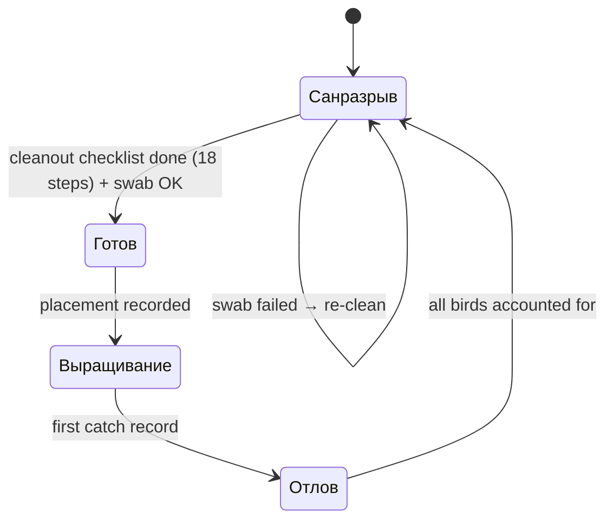
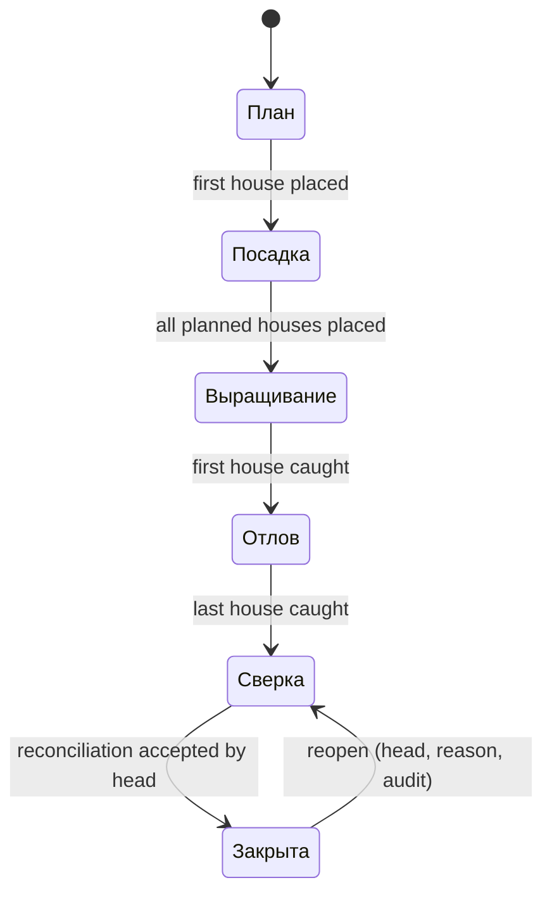
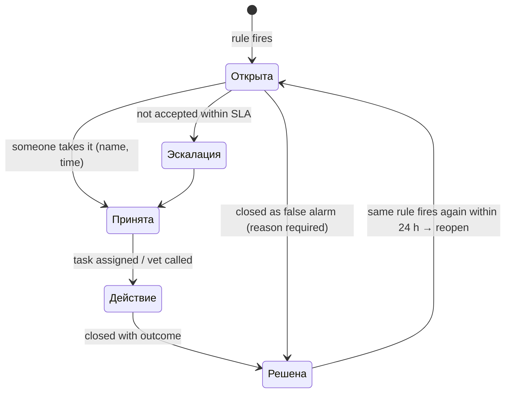
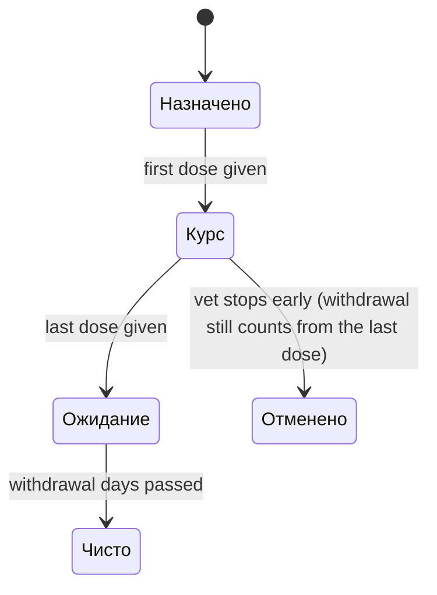

# Broiler Farm App — Business Logic v0.1
2026-11-24 · v0.2 (roles, withdrawal, edit window and catch decisions confirmed) · complements `BLUEPRINT.md` (what and why) and `DESIGN_BRIEF.md` (how it looks). This file defines **how the app behaves**: roles, object lifecycles, calculations, rules and edge cases.

---

## 1. Roles: capabilities, not people

**Principle:** a role is a set of permissions. One person can hold several roles. On a mid-size farm the owner usually *is* the manager, so the app must not force two accounts or two apps.

### Default roles
| Role | Who (typical) | Can do |
|---|---|---|
| **Руководитель** (head) | owner-manager | everything: batches, plans, norms, users, approvals, reports |
| **Оператор** | house worker | own house(s): daily log, weighing, tasks, placement checks |
| **Ветврач** | vet | health records, treatments, withdrawal, approve catch overrides |
| **Кладовщик** | storekeeper | feed deliveries, bin stock, transfers |
| *Наблюдатель* (later, only if needed) | investor, accountant | read-only dashboards and reports |

- The owner and manager screens in the mockups become **one role, Руководитель**: the desktop is for deep work, the phone is for a quick check, both with the same rights.
- ✅ Confirmed: the owner runs the farm, so there is **one Руководитель role**. Наблюдатель is kept in the model for later (accountant/investor), not built in the MVP.

### 1.1 Permission matrix (capability → roles)
| Capability | Руков. | Опер. | Вет. | Клад. | Набл. |
|---|---|---|---|---|---|
| Open/close batch, placement record | ✔ | — | — | — | view |
| Daily log: create/edit own house ≤ 48 h | ✔ | ✔ | — | — | view |
| Edit a locked log (> 48 h) with reason | ✔ | — | — | — | — |
| Weighing | ✔ | ✔ | view | — | view |
| Treatments, vaccinations | view | tasks only | ✔ | — | view |
| Override the withdrawal block on catch ✅ | ✔ + reason | — | ✔ + reason | — | — |
| Feed deliveries, transfers, stock adjust | ✔ | — | — | ✔ | view |
| Norm tables, alert thresholds | ✔ | — | view | — | view |
| Users and houses setup | ✔ | — | — | — | — |

### 1.2 Approvals (four-eyes rule) — not in MVP
Not needed with one head. Possible later setting, where these actions would need a second person:
- override the withdrawal block (vet + head)
- edit a closed batch report
- a stock adjustment > 1 t

---

## 2. Core objects and lifecycles


**House (Птичник):** the house state drives what the operator sees: the cleanout checklist, or Today with the daily log.


**Batch (Партия):** one farm-wide batch with a HouseBatch per house. Each HouseBatch has its own placement date, so **day of age is calculated per house**, never per farm.

### 2.1 Daily log (Журнал дня)
| State | Meaning | Who can change it |
|---|---|---|
| Черновик | being typed, autosaved on the phone | operator |
| В очереди | saved on the phone, no network | operator |
| Принят | on the server; rules have run | operator ≤ 48 h |
| Закрыт | more than 48 h old | head only, with a reason (audit) |

- One log per house per **production day**, which runs 08:00 → 08:00 (setting). A late entry goes to the date it describes, not the date it was typed.
- An edit **re-runs the rules** for that day and every later day that depends on it (cumulative deaths, live birds, FCR).

### 2.2 Alert (Тревога)

- **One alert per rule per house per day.** Repeats update the existing alert instead of creating new ones (deduplication).
- **SLA:** тревога (critical) must be accepted within 2 h, else it escalates to the head and the vet; внимание (warning) by the end of the day.
- **Return to normal:** a warning auto-resolves as "нормализовалось" when the rule stops firing for 24 h. A critical alert always needs a human to close it.

### 2.3 Task (Задача)
| Source | Example | Created |
|---|---|---|
| **Age template** (AA norms) | day 7: weigh + change light; day 25: finisher feed | at placement, for the whole batch |
| **Event** | treatment → daily dosing tasks; alert → assigned action | when the event happens |
| **Recurring** | weekly nipple pressure, walk-through twice a day | rolling schedule |
| **Catch plan** | −3 d light 23 h, −2 d remove wheat, −8…12 h feed off | when the catch date is set; re-created if the date moves |

- **States:** Запланирована → Сегодня → Выполнена / Пропущена (reason required) / Просрочена (automatic at the end of its window).
- A task has a **window** (e.g. "day 24–25"), not a single moment, so a one-day slip is not a failure.

### 2.4 Treatment and withdrawal (Лечение и срок ожидания)

- **Earliest slaughter** = date of the last dose + withdrawal days + 1.
- The catch plan for that house is **blocked** while any treatment is in Курс or Ожидание and the slaughter time comes before its earliest slaughter date. An override needs the vet or head, with a reason, and goes to the audit log.

### 2.5 Feed movement (Корм)
Movements: **Поставка** (in) → bin of house X; **Расход** (daily log); **Перемещение** (bin X → bin Y); **Корректировка** (count result, with a reason).
- Bin stock = deliveries + transfers in − transfers out − daily consumption ± adjustments.
- Days left = bin stock / 3-day average consumption. The alert fires below 2 days (setting).

---

## 3. Calculations (single source of truth)

| Number | Formula | Notes |
|---|---|---|
| Day of age | today − placement date (per house) | day 0 = placement day |
| Live birds | placed − Σ deaths − Σ culls − Σ caught | recalculated whenever any log is edited |
| Mortality % (day) | (deaths + culls) / live birds at start of day × 100 | |
| Cumulative mortality % | Σ (deaths + culls) / placed × 100 | week 1 tracked separately |
| Feed g/bird/day | feed kg / live birds × 1000 | |
| Water L/day | (meter today − meter yesterday) × 1000 | meter replacement starts a new reading series |
| Water:feed | water L / feed kg | norm adjusted +6.5%/°C above 21 °C |
| Working temperature | min + ⅔ × (max − min) | AA Appendix 2 |
| Target temperature | AA Table 2 by age, adjusted by Table 3 for humidity, interpolated | |
| Avg weight, SD, CV% | from the weighing sample | group weighing gives the average only |
| Weight today (estimate) | interpolated between the last weighing and the norm curve | for the running FCR estimate |
| Running FCR | Σ feed / (live birds × estimated weight) | labelled "оценка" |
| Density kg/m² | live birds × estimated weight / floor area | the catch-day projection checks the farm limit |
| Final FCR | consumed feed (deliveries − end stock) / live kg sold | from the feed reconciliation, **not** from the logs |
| EPEF | survival % × avg kg / (age × FCR) × 100 | age = weighted by birds per catch day |
| Adjusted FCR | FCR + (target − actual kg) / 4.5 | shown only if the difference ≤ 0.227 kg |
| Unexplained birds | placed − deaths − culls − caught | > 0.2% → warning in the close report |
| Unexplained feed | consumed − Σ logged feed | > 1% → warning |

---

## 4. Rule engine

Every rule is data, not code, so the head can tune it:

```
rule: water_drop
metric: water_l_day
compare: change_vs_previous_day
threshold: -15%           # from settings
min_age: 3                # ignore the first days
severity: warning
notify: [head]
dedupe: per house per day
message: "Вода {value} л ({delta}% к вчера)"
causes: ["Ниппели, напор, утечки", "Здоровье — сообщить ветврачу"]
```

| Rule | Metric | Threshold (default) | Severity | Notify |
|---|---|---|---|---|
| Week-1 mortality | cumulative %, days 0–7 | > 0.7% warn, > 1% crit | warn / crit | head, vet |
| Mortality spike | day deaths vs 3-day average | > 2× and > 0.05% | crit | head, vet |
| Water change | day L vs previous day | ±15% | warn | head |
| Water:feed | ratio vs adjusted norm | outside 1.6–1.8 | warn | head |
| Temperature | working t vs target | ± 1.5 °C | warn | head |
| Humidity | RH | < 50% before day 10; > 70% after day 18 | warn | head |
| Crop fill | % at 24 h | < 95% | warn | head |
| Day-7 weight | weight vs day-0 | < 4× | warn | head |
| Uniformity | CV% | > 10 | warn | head |
| Weight vs norm | avg weight | < −5% warn, < −10% crit | warn / crit | head |
| Feed bin | days left | < 2 | warn (crit < 1) | storekeeper, head |
| Missing log | no log by 11:00 | — | warn | head |
| Density at catch | projected kg/m² | > farm limit | warn | head |
| Withdrawal vs catch | earliest slaughter > catch time | — | **block** | head, vet |

**Combining rules:** when two or more rules fire for the same house on the same day (e.g. mortality spike + water drop), the app shows **one** combined crit alert, "Возможна болезнь", and notifies the vet.

---

## 5. Data quality

- **Plausibility:** a value more than 5× the 7-day average, or outside physical limits (t < 0 or > 45 °C, RH > 100, a meter reading going backwards), asks the user to confirm; nothing is silently blocked.
- **Units:** feed can be entered as kg or as bags × bag weight (set per feed type).
- **Offline:** each record carries a device ID and timestamp. Conflict (two people edit the same log) → the later save wins, the earlier version is kept in history, and the head is notified.
- **Audit log:** every edit after acceptance records who, when, old → new value and the reason.
- **Missing days:** the system never fills in numbers. A missing day shows as a gap in charts and a "нет данных" warning in reports.

---

## 6. Edge cases the logic must handle

| Case | Behaviour |
|---|---|
| **Thinning (прореживание)** ✅ not used | one catch per house (the catch may span 1–2 nights → several catch records, one catch plan). The data model keeps catch as records so thinning can be added later |
| **Placement over several days** | each house has its own placement date and day of age; the batch shows a range |
| **Mixed parent flocks in one house** | placement records several sources; the chick report goes to each hatchery |
| **Separate-sex rearing** | HouseBatch has a sex field; norms are picked per sex |
| **Feed transferred between houses** | a Перемещение record; FCR per house stays correct |
| **Water meter replaced or broken** | "новый счётчик" starts a new series; a broken day is entered as "нет данных", not 0 |
| **Operator absent** | the head reassigns the house for a date range; tasks follow the house, not the person |
| **Batch reopened after close** | allowed for the head with a reason; the report gets a new version, old versions are kept |
| **Power or water failure** | an "Авария" event on the house timeline (type, start, end); excluded from rule baselines |
| **Mass mortality event (heat wave)** | an event links its alerts and the post-mortem; shown separately in the close report |

---

## 7. Decisions
| # | Question | Decision |
|---|---|---|
| 1 | Owner = manager? | ✅ Same person: one Руководитель role, no separate owner screens |
| 2 | Who overrides the withdrawal block? | ✅ Vet or head, reason required, audit log |
| 3 | Operator edit window | ✅ 48 h, then head only with a reason |
| 4 | Thinning | ✅ No: whole house at once |
| 5 | Production day: 08:00 → 08:00 or calendar date? | open (default 08:00 → 08:00) |
