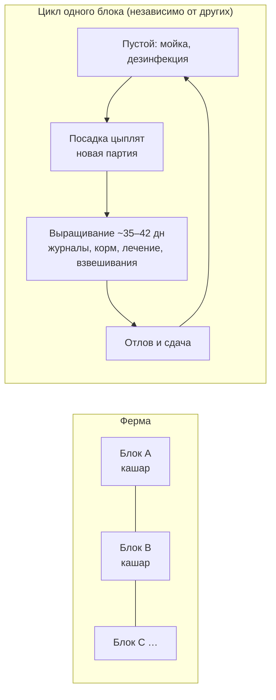
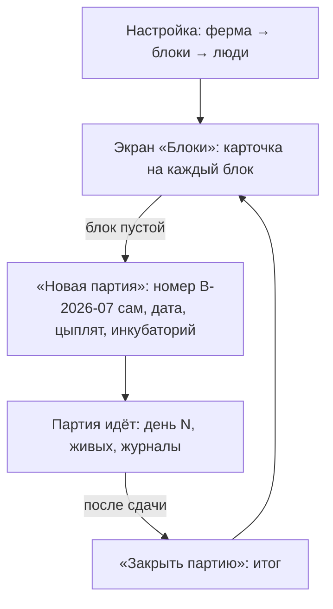

# Блоки (кашары) и партии — Product Blueprint (дополнение v3)
2026-11-28 · v3.0 · статус: решения владельца подтверждены (4 вопроса), детали — допущения

## 0. Коротко
- **Что меняется:** ферма — это **блоки (кашары)**: Блок A, Блок B… У **каждого блока свой цикл и своя партия** с автоматическим номером (`B-2026-07`). Сейчас приложение считает, что партия одна на всю ферму, — это неверно и путает настройку.
- **Ключевой цикл:** блок пустой → «Новая партия» (номер сам, дата, цыплята) → журналы каждый день → отлов и сдача → «Закрыть партию» → итог (сохранность, вес, конверсия, деньги) → блок снова пустой.
- **North Star:** доля блоков, у которых партия закрыта с полным итогом (без ручного Excel). Базы нет — первая партия её задаёт; цель 100% блоков.
- **Настройка фермы:** только 3 вещи — ферма, блоки, люди. «Нормы фермы» убираем из настройки: 6 понятных ключевых норм в «Настройках», полные таблицы Arbor Acres — только для чтения в «Справочнике».
- **Главный риск:** общие затраты (свет, газ, зарплата) не привязаны к блоку → итог по деньгам «на блок» неточен. **Проверка:** спросить директора, как он делит их сейчас; по умолчанию делим пропорционально посаженным головам.

## 1. Предметная область
### 1.1 Как устроено на ферме (as-is, со слов владельца)

- Блоки живут **в разных циклах**: в Блоке B может быть 23-й день, а Блок A пустой или на 5-м дне.
- Каждый блок — свой работник (один работник может вести несколько блоков).

### 1.2 Словарь
| Слово | Значение в приложении |
|---|---|
| **Блок (кашар, сарай)** | одно здание с птицей. В приложении — «Блок A», «Блок B» (было «П-1…П-4») |
| **Партия** | один цикл одного блока: посадка → отлов → итог. Номер `<блок>-<год>-<№>`, напр. `B-2026-07` (7-я партия Блока B в 2026) |
| **Пустой блок** | между партиями: мойка, дезинфекция, подготовка |
| **Ключевые нормы** | 6 чисел, по которым проверяется журнал; остальное — справочник |

### 1.3 Боли
| # | Проблема | Цена |
|---|---|---|
| 1 | Партия одна на ферму — нельзя посадить Блок A, пока Блок B растёт | приложение не отражает реальную работу; итоги неверные |
| 2 | Настройка смешана с 15 техническими таблицами норм | директор не понимает, что от него нужно; бросает настройку |
| 3 | Нет понятного «начать / закончить партию» для блока | нет итога по партии → решения о следующей партии вслепую |

## 2. Кто и зачем
| Роль | Задача | Успех |
|---|---|---|
| Директор | Видеть все блоки в одном месте: какой на каком дне, какой пустой; начинать и закрывать партии; знать итог каждой партии | итог партии без Excel в день закрытия |
| Работник | Видеть только свои блоки и писать журнал текущей партии | журнал ≤ 2 мин |

## 3. Как будет

| Шаг | Изменение |
|---|---|
| Номер партии | **автоматически**, можно исправить |
| Посадка | теперь это «Новая партия» в конкретном блоке (кто угодно из блока или директор) |
| Закрытие | новое: после сдачи директор закрывает партию → итог, блок становится пустым |
| Нормы | из настройки убраны; 6 ключевых — в «Настройках» |

## 4. Опыт
### 4.1 Навигация директора
- **Ферма** (что требует внимания + все блоки) · **События** · **Деньги** · **Люди** · **Профиль**. «Справочник» — на компьютере в меню, на телефоне в «Профиле».
- **Настройки фермы** (из «Профиля» и из «Людей»): Ферма · Блоки · Люди · Ключевые нормы.

### 4.2 Экраны
| Экран | Для кого | Что видно | Действия | Релиз |
|---|---|---|---|---|
| Блоки (главная часть «Фермы») | директор | карточка на блок: партия и день / «пустой с 20.11», живых, сохранность, журнал сегодня | открыть блок; «Новая партия» у пустого | R1 |
| Блок | директор, работник | текущая партия, день, журналы, история партий блока | «+ Записать», «Закрыть партию» (директор) | R1 |
| Новая партия | директор, работник | номер `B-2026-08` (сам), дата посадки, цыплят по накладной, павших в дороге, инкубаторий, возраст стада | сохранить → партия открыта | R1 |
| Закрыть партию | директор | итог: посажено, сдано голов и кг, сохранность, средний вес, конверсия корма, затраты и прибыль (если цены есть) | закрыть → блок пустой | R2 |
| Настройка фермы (мастер) | директор | 1 Ферма · 2 Блоки (A, B, C… одним нажатием) · 3 Люди | — | R1 |
| Ключевые нормы | директор | 6 чисел простыми словами + «как в Arbor Acres» рядом | изменить, вернуть AA | R1 |

### 4.3 Ключевые нормы (вместо 15 таблиц)
| Норма | По умолчанию (AA) |
|---|---|
| Падёж за сутки, не больше | 0,10% |
| Отход за первую неделю, не больше | 0,7% (тревога 1,0%) |
| Допуск температуры от цели | ±1,5 °C |
| Вода : корм | 1,6–1,8 (по типу поилок) |
| Однородность (CV), не больше | 10% |
| Снятие корма перед отловом | 8–12 ч |

### 4.4 Правила
- Номер партии уникален на ферме; формат `<буква блока>-<год>-<№ по блоку>`.
- В блоке одновременно максимум **одна открытая партия**.
- Работник видит только свои блоки; закрывает партию только директор.
- Деньги: прямые затраты (цыплята, корм, лекарства) — на партию блока; общие (свет, газ, зарплата) — делятся по посаженным головам за период (допущение).

## 5. План
| Релиз | Что | Готово, когда |
|---|---|---|
| **R1 · M** | Партия на блок (миграция: текущая партия → по партии на каждый блок с номерами), «Блоки», «Новая партия», мастер настройки, ключевые нормы, переименование «Птичник» → «Блок» | на чистой ферме: 3 блока, партия только в Блоке B, работник пишет журнал; Блок A пустой и это видно |
| **R2 · M** | Закрытие партии и итог; деньги по партии блока; общие затраты делятся | итог первой реальной партии совпадает с ручным расчётом директора |
| **R3 · L** | Редизайн v3 всех экранов по макету (одна кнопка «+ Записать» в блоке) | работник проходит журнал ≤ 2 мин на своём телефоне |

**Вне объёма:** несколько ферм; партия на несколько блоков сразу; планирование будущих посадок.

**Риски и допущения**
| Допущение | Если неверно | Как проверить |
|---|---|---|
| Общие затраты делятся по головам | итог по деньгам неточен | спросить, как считает сейчас |
| Буква блока = A, B, C… | у фермы свои названия | название блока редактируется, буква берётся из названия |
| Одна партия = один блок | бывает посадка «на два блока» | спросить; иначе — две партии с одной датой |

## 6. Передача в jarvis
- **Цель:** партия принадлежит блоку; настройка = ферма, блоки, люди, ключевые нормы.
- **Истории:** (1) директор добавляет блоки A–C одним действием; (2) работник/директор начинает новую партию в пустом блоке, номер присваивается сам; (3) директор видит все блоки с их днём и статусом; (4) директор закрывает партию и видит итог; (5) директор меняет 6 ключевых норм простыми словами.
- **Данные:** `house` = блок (+ `code` буква); `batch` получает `house_id`, `seq`, `number` (`B-2026-07`), `placed_on`, `closed_at`; `house_batch` остаётся 1:1 с партией (совместимость); затраты получают `scope` (партия | общие).
- **Миграция:** существующая общая партия → по одной партии на каждый блок с тем же днём посадки.
- **Открытые вопросы:** деление общих затрат; посадка на несколько блоков сразу.
