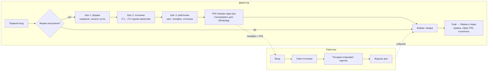

# Директор: настройка фермы и работники — Product Blueprint (дополнение к BLUEPRINT v2.1)
2026-11-27 · v2.2 · статус: решения подтверждены владельцем (4 вопроса), детали — допущения

## 0. Коротко
- **Что:** директор сам заводит ферму, птичники и работников и управляет ими, без разработчика и без Supabase.
- **Ключевой цикл:** первый вход → мастер «Ферма → Птичники → Работники» → работник входит по телефону и PIN → первая посадка открывает партию → журналы идут директору.
- **North Star этого блока:** время от первого входа директора до первого журнала работника. Сейчас: нужен разработчик (дни). Цель: **≤ 30 минут**, без посторонней помощи.
- **В объёме:** одна ферма; мастер первого входа; экран «Ферма и люди» (ферма, птичники, работники); сброс PIN; отключение и возврат работника; правка имени, телефона, птичников.
- **Вне объёма:** несколько ферм; вход по SMS или ссылке; другие роли (ветврач, заместитель); самостоятельная регистрация новых директоров.
- **Главный риск:** директор забудет или потеряет PIN работника → работник не войдёт. **Проверка:** сброс PIN за 3 нажатия; PIN показывается один раз крупно, с кнопкой «Скопировать для WhatsApp».

## 1. Как сейчас (as-is)
| # | Шаг | Кто | Проблема | Цена |
|---|---|---|---|---|
| 1 | Ферму и аккаунт директора создаёт разработчик скриптом | разработчик | директор не может начать сам | дни ожидания |
| 2 | Птичники и работники добавляются внизу «Ещё → Настройки» | директор | не видно, что делать первым; экран пустой без подсказок | путаница, звонки |
| 3 | Работник забыл PIN | работник → директор | сбросить нельзя, только через разработчика | работник не пишет журнал → пропуски |
| 4 | Работник уволился | директор | отключить нельзя; телефон по-прежнему входит | риск доступа к данным |
| 5 | Ошибка в имени или телефоне | директор | исправить нельзя | неверные контакты |
| 6 | Название фермы, начало производственных суток | директор | не редактируется | расхождение с реальностью |

## 2. Кто и зачем
| Роль | Задача (JTBD) | Контекст | Успех |
|---|---|---|---|
| Директор | Когда запускаю ферму в приложении, хочу сам завести птичники и людей, чтобы завтра все писали журналы | телефон или ноутбук, контора, онлайн, 15–30 мин | все работники вошли в первый день |
| Директор | Когда работник забыл PIN или ушёл, хочу за минуту выдать новый PIN или закрыть доступ | телефон, где угодно, онлайн | работник снова работает в тот же час |
| Работник | Когда получил телефон и PIN, хочу войти и видеть только свои птичники | свой Android, птичник | вошёл с первого раза |

## 3. Как будет (to-be)

| Шаг | Изменение |
|---|---|
| Создание фермы разработчиком | **остаётся один раз** — первичный аккаунт директора создаём мы (самостоятельной регистрации нет) |
| Настройка фермы | **директор сам**, мастер при первом входе |
| Сброс PIN, увольнение, правка | **директор сам**, в любой момент |
| Вход работника | без изменений (телефон + PIN) |

## 4. Опыт пользователя
### 4.1 Сценарии
**Первый вход директора (ферма пустая: нет птичников)**
1. Вход → вместо пустой «Фермы» открывается **«Настройка фермы · шаг 1 из 3»**.
2. **Ферма:** название (уже заполнено), начало производственных суток (08:00), часовой пояс (Бишкек). «Дальше».
3. **Птичники:** кнопка «Добавить 4 птичника П-1…П-4» + поле «сколько»; у каждого площадь м² и есть ли водосчётчик. Можно переименовать. «Дальше» — только если есть хотя бы один птичник.
4. **Работники:** имя, телефон, отметить птичники; PIN приложение предлагает само (6 случайных цифр, можно изменить). После «Добавить» — карточка с номером и PIN крупно и кнопкой «Скопировать для WhatsApp». Можно добавить ещё или «Готово».
5. «Готово» → «Ферма» с подсказкой: «Первая посадка открывает партию — её записывает работник или вы (Ещё → Посадка)».
- **Ошибки:** телефон уже занят → «Этот номер уже есть у Айгуль Т.»; нет сети → «Настройка работает только онлайн», ввод сохраняется; птичник без работника → предупреждение, не блок.
- Мастер можно прервать; при следующем входе продолжается с первого незавершённого шага.

**Работник забыл PIN:** «Ещё → Ферма и люди → Работники → Айгуль → Новый PIN» → PIN показан один раз + копировать. Старый PIN сразу не работает; уже открытая сессия на телефоне работника завершается при следующей синхронизации.

**Работник ушёл:** карточка → «Отключить» → подтверждение. Вход закрыт, журналы и события остаются с его именем; в списке он в разделе «Отключены», его можно «Вернуть».

**Правка:** имя, телефон (меняется логин; работнику сообщить), птичники (чипы). Правка птичников действует сразу после синхронизации.

### 4.2 Навигация директора
- Нижнее меню без изменений: Ферма · События · Деньги · Птичники · Ещё.
- «Ещё»: первым пунктом **«Ферма и люди»** (вместо «Настройки»), затем Справочник, Помощник, Нормы фермы, Посадка, Взвешивание, Отлов, Отправка и PIN.
- «Ферма» без птичников → кнопка «Настроить ферму» (на случай, если мастер закрыли).

### 4.3 Экраны
| Экран | Роль | Данные | Действия | Релиз |
|---|---|---|---|---|
| Мастер, шаг 1 «Ферма» | директор | название, начало суток, часовой пояс | сохранить, дальше | MVP |
| Мастер, шаг 2 «Птичники» | директор | список, площадь, водосчётчик | добавить N разом, переименовать, удалить пустой | MVP |
| Мастер, шаг 3 «Работники» | директор | имя, телефон, птичники | добавить, показать PIN, копировать | MVP |
| Ферма и люди | директор | ферма; птичники; работники (активные, отключены) | открыть карточку | MVP |
| Карточка работника | директор | имя, телефон, птичники, последний журнал | изменить, новый PIN, отключить, вернуть | MVP |
| Карточка птичника | директор | название, площадь, водосчётчик, работники | изменить; удалить, если нет данных | MVP |

### 4.4 Правила
- **Права:** всё на этих экранах — только директор (проверяет сервер). Работник видит в «Отправка и PIN» только смену своего PIN.
- **Онлайн:** настройка, сброс PIN, отключение — только онлайн, с понятным сообщением; ввод не теряется.
- **PIN** нигде не хранится открыто и не показывается повторно; только «Новый PIN».
- **Удаление:** птичник с журналами и работник с записями не удаляются — только отключаются (история нужна для партии и денег).
- **Язык:** русский; номера в формате +996 XXX XX XX XX.

## 5. Дорожная карта
| Функция | MoSCoW | Почему |
|---|---|---|
| Мастер первого входа (3 шага) | Must | без него директор не знает, с чего начать |
| Сброс PIN | Must | иначе забытый PIN = пропущенные журналы |
| Отключить и вернуть работника | Must | безопасность при увольнении |
| Правка имени, телефона, птичников | Must | ошибки ввода неизбежны |
| Правка фермы (название, начало суток) | Should | редко, но нужно |
| Правка и удаление птичника | Should | ошибки при настройке |
| Несколько ферм, SMS, другие роли | Won't (сейчас) | решение владельца |

**Релиз «Настройка директора» (S–M, ~3–4 дня):** все Must и Should выше. **Критерий готовности:** директор на чистой ферме сам заводит 4 птичника и 2 работников; работник входит и пишет журнал; сброс PIN и отключение работают; всё покрыто тестами.

**Риски и допущения**
| Допущение | Если неверно | Как проверить |
|---|---|---|
| Директор передаёт PIN через WhatsApp | PIN теряется | спросить на пилоте; кнопка копирования |
| Начало суток 08:00 одно на ферму | нужно по птичникам | спросить директора на пилоте |
| Один телефон = один работник | общий телефон на смену | смотреть на пилоте; при необходимости — смена пользователя |

## 6. Передача в jarvis
- **Цель:** директор сам настраивает ферму и управляет доступом работников.
- **Роли:** head (всё), worker (только свои птичники; свой PIN).
- **Истории:**
  1. Как директор при первом входе я прохожу 3 шага (ферма, птичники, работники), чтобы сразу начать работу.
  2. Как директор я добавляю работника с телефоном, птичниками и предложенным PIN и копирую данные для WhatsApp.
  3. Как директор я выдаю работнику новый PIN; старый перестаёт работать сразу.
  4. Как директор я отключаю ушедшего работника и при необходимости возвращаю; история сохраняется.
  5. Как директор я меняю имя, телефон и птичники работника.
  6. Как директор я меняю название фермы и начало производственных суток.
  7. Как директор я правлю птичник и удаляю пустой.
- **Данные:** farm (name, tz, day_start_hour), house (name, area_m2, has_water_meter, active), app_user (display_name, phone, role, active), house_worker; auth.users (email из телефона, пароль = PIN).
- **Интеграции:** Supabase Auth Admin API — только в edge-функции (service role ключ не попадает в браузер).
- **Ограничения:** только онлайн для этих операций; RLS; одна ферма на директора; русский интерфейс; Android Chrome.
- **Открытые вопросы:** общий телефон на смену? нужен ли журнал «кто когда сбросил PIN» (предложение: да, в событиях директора).
