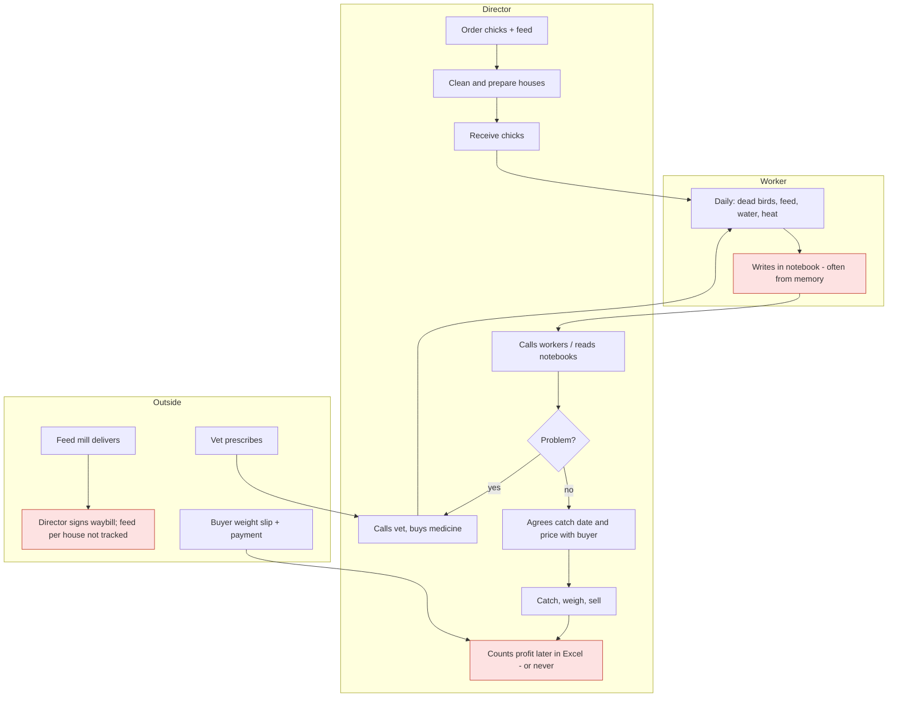
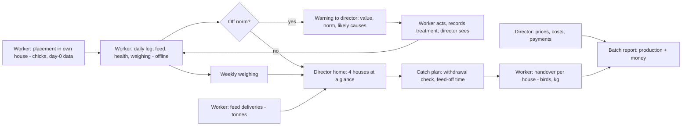
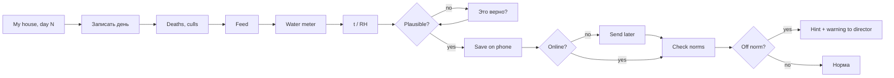
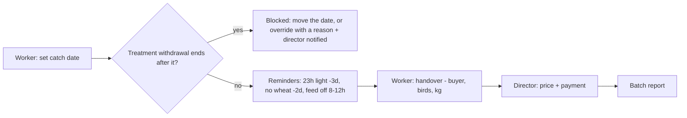

# Broiler Farm App — Product Blueprint
2026-11-27 · **v2.1** (role model changed: workers run all operations, the director sees everything; v1 is in `archive/v1/`) · status: draft
Knowledge base: `knowledge/` (Arbor Acres Handbook 2015 + Russian broiler guide).

**Confirmed by you:**
- 3–4 houses, 40–80k birds
- two roles: **director** (sees everything incl. money, can do anything, approves nothing) + **workers** (all equal; run every operation for their own houses; never see money)
- workers use their own Android phones
- the first version covers daily records, early warnings, batch results and money

Everything else marked ⚠️ is an assumption.

---

## 0. Summary

| | |
|---|---|
| **What it is** | A simple app for one broiler farm: workers record every operation of their houses on their phones (daily log, feed, health, placement, weighing, catch); the director sees everything the same day, including money, and gets a full batch result with profit, without Excel. |
| **Core loop** | Open batch → daily house log → warning if off-norm → weekly weight → catch & sale → **batch report: production + money** |
| **North Star** | **EPEF per batch** ⚠️ baseline ~280 → target ≥ 310 in 3 batches |
| **Owner's number** | **Profit per kg live weight** per batch |
| **Input metric** | ≥ 95% of house-days logged |
| **MVP in** | daily log · weekly weighing · 8 warnings · feed deliveries · treatments with withdrawal check · catch & sale · costs · batch report |
| **MVP out** | warehouse, payroll, 1C, sensors, multi-site, task calendar beyond key dates, approval workflows |
| **Biggest risk** | workers stop logging. **Test:** 1 house, 2 weeks, before the build |

### 0.1 The farm we design for ⚠️
| Item | Assumption |
|---|---|
| Houses | **4 houses × ~17,000 birds ≈ 68,000 per batch**, ~1,000 m² each |
| Breed / system | Arbor Acres, mixed sex, floor litter, nipple drinkers, pan or chain feeders, heaters, simple fans |
| Batch | all-in/all-out: all houses placed within 1–2 days, whole house caught at once; grow 40–42 days + 14–18 days cleanout ≈ **6 batches/year** |
| Team | **Director** (owner, 1 person) + **2–4 workers**, all equal, each responsible for 1–2 houses + contracted vet (tells the worker what to give; not an app user) + hired catching crew |
| Feed | bought pelleted (starter/grower/finisher), delivered straight into house bins or in bags; the worker of that house receives it and records the tonnes; the director records the price |
| Sales | live birds by weight to 1–3 buyers (processor, wholesalers), some on credit |
| Today | paper notebook per house, numbers phoned in or sent on WhatsApp/Telegram, director's Excel or notebook |
| Devices | workers' own Android phones; weak signal inside houses; director has a phone + laptop |
| Language | Russian (Kyrgyz later) |

### 0.2 Role model (v2.1) — who does what
**Principle:** the people in the houses record what happens there; the director watches, corrects and owns the money.

| Operation | Worker (own houses) | Director |
|---|---|---|
| Daily log: deaths, culls, feed given, water, t, RH | **records** | sees, can correct |
| Feed delivery into a bin (date, feed type, tonnes, waybill photo) | **records** | sees; **enters the price** |
| Feed phase change (старт → рост → финиш) | **records** (reminder) | sees |
| Health: vaccination, treatment (product, dose, days, withdrawal), post-mortem | **records** (from the vet's instructions) | sees, **notified at once**; enters medicine cost |
| Placement: chicks received, transport deaths, parent-flock age, day-0 weight, crop fill | **records** | sees; **enters the chick price** |
| Weighing (weekly) | **records** | sees |
| Catch plan: date, feed-off time | **records** | sees, can change |
| Catch inside a withdrawal period | can override **with a reason** | **notified at once** (no approval step) |
| Handover to buyer: buyer, birds, kg, transport deaths, weight-slip photo | **records** | sees; **enters price per kg and payments** |
| Other costs (gas, coal, power, wages, litter, vet visits) | — | **records** |
| Houses, workers, norms, thresholds, prices | — | **sets up** |
| Batch report | production part of own houses, no money | everything incl. profit; closes the batch |

**Money is invisible to workers.** Prices, costs, sums, revenue, profit and buyer debts are stored in separate finance records that the server never sends to a worker (enforced by database access rules, not only hidden in the screens).

**No approvals.** Nothing waits for the director. Instead, the director is notified immediately about: a new treatment, a catch override inside withdrawal, an edit older than 48 h (director-only), and every critical warning.

---

## 1. Domain & workflow (as-is)

### 1.1 Actors
| Role | Inside / outside | Uses app? | Count |
|---|---|---|---|
| **Director** (owner) | inside | **Yes**: sees all houses, operations and money; can enter or correct anything; enters prices, costs and payments | 1 |
| **Worker** | inside | **Yes**: every operation of their own houses — daily log, feed deliveries, health, placement, weighing, catch and handover. No money | 2–4 |
| Vet (contracted) | outside | No: tells the worker what to give; the worker records it, the director sees it | 1 |
| Hatchery, feed mill | outside | No | 1–2 each |
| Buyers | outside | No: the worker records birds and kg handed over; the director records price and payment | 1–3 |
| Catching crew | outside | No | crew |

### 1.2 Current workflow (one batch)

**Exceptions that matter**
- deaths spike
- water drops
- a bin runs empty
- a catch date clashes with medicine withdrawal
- the buyer's weight slip doesn't match
- a worker is absent

### 1.3 Information inventory
| Data | Created by | Used by | Today | Frequency |
|---|---|---|---|---|
| Placement: chicks, hatchery, parent-flock age, transport deaths, day-0 weight | director | director, hatchery | paper / none | per batch |
| Daily: deaths, culls, feed, water meter, t min/max, RH | worker | director | notebook | daily × 4 |
| Weekly weight (sample) | worker / director | director | rarely | weekly |
| Feed delivery: date, type, tonnes, house, price | director | director | waybills | 1–2/week |
| Treatment / vaccine: product, dose, days, withdrawal | director (from vet) | director | memory | as needed |
| Catch & sale: birds, kg, buyer, price, paid | director | director | slips, notebook | per batch |
| Other costs: chicks, litter, gas/coal, electricity, labour, vet | director | director | notebook | per batch |

### 1.4 Pain points (68k birds) ⚠️ estimates
| # | Problem | Cost per batch |
|---|---|---|
| P1 | Problems seen 1–3 days late | +1% mortality ≈ **680 birds ≈ 1.7 t live weight** |
| P2 | No FCR until the end, feed not tracked per house | +0.1 FCR ≈ **~17 t feed** |
| P3 | Profit per batch unknown or weeks late | can't tell a good batch from a bad one |
| P4 | Director phones around and re-types numbers | ~1 h/day |
| P5 | Withdrawal tracked from memory | rejected birds or a fine |
| P6 | Key age steps missed (light, feed phase, feed withdrawal) | weight and uniformity loss |

### 1.5 Rules & constraints
- Norms: **Arbor Acres**, stored as an editable table.
- Withdrawal: per the drug label; it must block a catch date that comes too early.
- Offline: house entries must work with no signal and sync later.
- Field use: one hand, dirty hands, dim light; big buttons, numeric keypad, ≤ 6 fields per screen.
- Russian UI at launch.

### 1.6 Glossary
| Term | Meaning |
|---|---|
| Партия | batch |
| Птичник | house |
| Посадка | placement |
| Падёж / Выбраковка | dead birds / culls |
| Сохранность | survival % |
| Живая масса | live weight |
| Однородность (CV%) | uniformity |
| Кормоконверсия (FCR) | kg feed per kg live weight |
| ИЭП (EPEF) | efficiency index |
| Срок ожидания | withdrawal period |
| Выдержка без корма | feed withdrawal before catch |
| Отлов | catch |
| Санразрыв | cleanout |
| Старт / рост / финиш | feed phases |

---

## 2. Users & jobs

| Role | Job (JTBD) | Context | Success |
|---|---|---|---|
| **Worker** | When something happens in my house — the morning round, a feed truck, the vet's instructions, chicks arriving, catch night — I want to record it on my phone in a minute, so the director knows without calls and I see if anything is wrong. | Inside the house, own phone, often no signal, 1–2 min per entry | daily log in < 2 min, ≥ 95% of days; every delivery, treatment and catch recorded the same day |
| **Director** | When I check the farm, I want to see everything that happened in every house and what it cost, and fix anything that's wrong, so I can act early and know the profit of each batch. | Phone around the farm, laptop in the evening | problems seen the same day; batch report incl. profit within 2 days of the last sale |

---

## 3. To-be workflow

| Step | Change |
|---|---|
| Notebook → phone log | **removed** paper and re-typing |
| Survival, FCR, EPEF, density, profit | **automated** |
| Off-norm detection | **visible same day** |
| Withdrawal vs catch | **automated block** |
| Key age steps (light, feed phase, weighing, feed-off) | **reminders** |
| Heating, ventilation, vet visits | stay offline; the app records the result only |

**Value proposition:** *every house checked against Arbor Acres norms every day, and every batch closed with real FCR and profit, without paper or Excel.*

---

## 4. User experience

### 4.1 Key journeys

**Worker: daily log (< 2 min)**
1. Opens the app on "My house · day 23".
2. Taps **Записать день** and enters:
   - deaths and culls (+/−)
   - feed (kg, or bags)
   - water meter reading
   - t min/max and RH
3. Saves the log. They see a green "норма" or a hint ("Water −18%: check nipples, the director has been told").

Unhappy paths:
- **No signal:** the log saves on the phone and sends later.
- **Forgot yesterday:** they can still fill it within 48 h.
- **Typing mistake** (e.g. 90 instead of 9): the app asks "Это верно?".

**Worker: feed truck arrives**
1. Taps **Корм → Поставка**, picks the bin's house, feed type, tonnes from the waybill, takes a photo of the waybill.
2. Saves (works offline). The bin stock and days left update; the director sees the delivery and adds the price later.

**Worker: vet prescribes a treatment**
1. Taps **Здоровье → Лечение**, enters product, dose, course days and withdrawal days from the vet's instructions.
2. Saves. The app shows the earliest slaughter date and creates a daily dosing task. The director is notified at once.

**Worker: chicks arrive / weighing day / catch night**
- **Placement:** count from the waybill, transport deaths, parent-flock age, 1 box weighed; crop-fill checks at 2–48 h.
- **Weighing:** sample weights → average and CV%.
- **Catch:** sets the date; if a treatment's withdrawal is still running the date is blocked — the worker can move it or override with a reason (director notified). On catch night records feed-off time, then per house the buyer, birds, kg and the weight-slip photo.

**Director: morning**
1. Opens Ферма: all houses with status, day of age, survival, today's deaths, water:feed, feed days left, and a feed of today's events (deliveries, treatments, overrides).
2. Taps a red house to see the trends against the norm, the warning, likely causes and what the worker did.
3. Corrects anything if needed (all edits are kept in history).

Unhappy path: a house has no log by 11:00, so the app shows "нет журнала" with the worker's name and a call button.

**Director: money and end of batch**
1. Adds prices to new deliveries, the chick price, medicine costs and other costs (gas, power, wages…).
2. After the catch, adds price per kg and payments to each handover the workers recorded.
3. The batch report opens: production (survival, weight, FCR, EPEF) + money (costs by category, revenue, profit per kg and per bird, owed) + bird and feed reconciliation. Closes the batch, and the report locks.

### 4.2 User flows

### 4.3 Navigation
| Role | Tabs | Home screen |
|---|---|---|
| Worker (phone) | **Сегодня** · Журнал · Корм · Здоровье · Ещё (посадка, взвешивание, отлов, отправка) | my house(s), day of age, today's tasks (dosing, weighing, feed phase, catch steps), a big "Записать день" button, sync status |
| Director (phone and laptop, same app) | **Ферма** · Партия · Деньги · Отчёты · Настройки | Ферма: all houses + open warnings + today's events from the workers |

### 4.4 Screens
| # | Screen | Worker | Director | Purpose |
|---|---|---|---|---|
| 1 | Сегодня | ✔ own houses | — | today's tasks and log status |
| 2 | Журнал дня | ✔ records ≤ 48 h | ✔ sees, corrects any | daily entry + norm check |
| 3 | Корм: поставка, остаток в бункере, смена рациона | ✔ records (tonnes, no price) | ✔ sees, adds price | feed in, bin stock, days left |
| 4 | Здоровье: вакцинация, лечение, вскрытие | ✔ records | ✔ sees, notified | withdrawal → earliest slaughter |
| 5 | Посадка | ✔ records | ✔ sees, adds chick price | chicks in, crop fill |
| 6 | Взвешивание | ✔ records | ✔ sees | average, CV% |
| 7 | Отлов и сдача | ✔ plans + records handover | ✔ sees, adds price + payment | withdrawal block, feed-off, birds/kg |
| 8 | Ферма | — | ✔ | all houses, warnings, today's events |
| 9 | Птичник | ✔ own house, no money | ✔ everything | trends vs norm, history |
| 10 | Деньги: цены, затраты, оплаты | — | ✔ | prices, costs, payments, debts |
| 11 | Отчёт партии | ✔ production of own houses | ✔ production + money | close batch, export |
| 12 | Настройки | — | ✔ | houses, workers, norms, thresholds |
| — | Отправка (sync queue, PIN) | ✔ | ✔ | offline queue, change PIN |

### 4.5 Cross-cutting rules
- **Notifications (director):** immediately — critical warnings, new treatments, catch overrides inside withdrawal; at 18:00 — daily summary; at 11:00 — missing logs. Workers see hints on save and their tasks.
- **Permissions:** a worker sees and records only their own houses, edits their records ≤ 48 h, never sees prices, costs, revenue, profit or debts (server-enforced). The director sees and edits everything; edits older than 48 h need a reason. Nothing needs approval.
- **Offline:** all worker screens work offline (daily log, feed, health, placement, weighing, catch). The director's screens show cached data with "обновлено N мин назад".
- **States:** every list has empty, loading and error states. The worker sees "нет партии" during cleanout.
- **Field use:** touch targets ≥ 48 dp, +/− buttons for counts, numeric keypad, photo of waybills and weight slips, high contrast.

---

## 5. How the app works (logic)

### 5.1 Objects and their states
| Object | States | Rule |
|---|---|---|
| **Batch** | Открыта → Отлов → Закрыта | closing locks the report; the director can reopen it with a reason |
| **House in batch** | Посадка → Выращивание → Отловлен | day of age counted from **this house's** placement date |
| **Daily log** | На телефоне → Отправлен → Закрыт (after 48 h) | one per house per day; an edit recalculates everything after it |
| **Warning** | Открыта → Отмечена (action noted) → Закрыта | one per rule per house per day; closes itself after 24 h back in norm |
| **Treatment** | Курс → Ожидание → Чисто | earliest slaughter = last dose + withdrawal days + 1; blocks catch until then |

### 5.2 Calculations
| Number | How |
|---|---|
| Live birds | placed − Σ deaths − Σ culls |
| Mortality % | daily and cumulative; week 1 shown separately |
| Feed per bird | feed kg / live birds |
| Water | meter today − meter yesterday |
| Water:feed | water L / feed kg; norm 1.6–1.8, +6.5% per °C above 21 °C |
| Working temperature | min + ⅔ × (max − min), against AA Table 2 by age |
| Average weight, CV% | from the weighing sample |
| FCR (running) | Σ feed / (live birds × last weight), marked "оценка" |
| FCR (final) | (feed delivered − feed left) / kg sold |
| EPEF | survival % × kg / (age × FCR) × 100 |
| Density | live birds × weight / m² |
| Feed days left | bin stock / 3-day average use |
| Cost per batch | Σ chicks + feed + medicine + litter + energy + labour + vet + other |
| Revenue | Σ kg sold × price |
| Profit | revenue − costs; also per kg live and per bird placed |
| Bird check | placed − deaths − culls − sold (unexplained if > 0.2%) |
| Feed check | delivered − left − logged (unexplained if > 1%) |

### 5.3 Warnings in MVP: 8 rules, thresholds editable
| Warning | Fires when |
|---|---|
| Week-1 mortality | > 0.7% cumulative by day 7 (critical > 1%) |
| Mortality spike | today > 2× the 3-day average |
| Water change | ±15% vs yesterday |
| Water:feed | outside the adjusted norm |
| Temperature | working t outside AA target ± 1.5 °C |
| Weight / uniformity | weight < −5% of norm*, or CV% > 10 |
| Feed bin | < 2 days left |
| No log | missing by 11:00 |

If two or more fire for one house on the same day, they are shown as one **"Возможна болезнь — позвоните ветврачу"**.
*Weight norm needs the AA Performance Objectives booklet; until then it is a placeholder.

### 5.4 Reminders (created from the placement date)
- **Day 0:** crop fill at 24 h ≥ 95%.
- **Day 7:** weigh, then switch to 4–6 h darkness.
- **~Day 10:** starter → grower.
- **Day 18:** pellets.
- **~Day 25:** finisher.
- **Weekly:** weighing.
- **Before catch:** −3 d 23 h light, −2 d no whole wheat, −8…12 h feed off.

---

## 6. Roadmap

### 6.1 Prioritization (RICE-lite)
| Feature | R | I | C | E | Score | MoSCoW |
|---|---|---|---|---|---|---|
| Daily log (offline) | 5 | 5 | 5 | 3 | 42 | Must (enabler) |
| Farm view + 8 warnings | 4 | 5 | 4 | 3 | 27 | Must |
| Batch report (production) | 3 | 5 | 5 | 2 | 38 | Must |
| Catch & sale + withdrawal check | 3 | 5 | 5 | 2 | 38 | Must |
| Feed deliveries + costs → profit | 3 | 5 | 4 | 2 | 30 | Must |
| Weekly weighing | 4 | 4 | 5 | 2 | 40 | Must |
| Age reminders | 4 | 3 | 4 | 1 | 48 | Should |
| Telegram notifications | 2 | 3 | 4 | 1 | 24 | Should |
| Buyer debts tracking | 1 | 3 | 4 | 1 | 12 | Could (v1) |
| Cleanout checklist | 2 | 3 | 4 | 1 | 24 | Could (v1) |
| Batch-to-batch comparison | 1 | 4 | 4 | 2 | 8 | v1 |
| Sensors, 1C, multi-site | — | — | — | — | — | Won't (now) |

### 6.2 Releases ⚠️ assumes 1–2 developers
| Release | Goal | Content | Exit criterion | Size |
|---|---|---|---|---|
| **Test (before build)** | will workers log daily? | Telegram bot or Google Form, 1 house | ≥ 12 of 14 days logged | 2 weeks |
| **MVP** | one full batch in the app, including profit | screens 1–11, 8 warnings, reminders | 4 houses, ≥ 95% logs for a full batch; report matches a manual check within 1% | ~8 weeks |
| **Pilot batch** | prove it | run, fix, measure | director stops paper/Excel | ~6 weeks |
| **v1** | learn across batches | batch comparison, cleanout checklist, buyer debts, Kyrgyz UI | EPEF ↑ over 2 batches | ~4 weeks |
| **v2** | less typing | climate-controller / water-meter import if the houses have them | — | later |

### 6.3 Out of scope, and why
- **Separate vet and storekeeper roles:** the director does it; add them only if the team grows.
- **Warehouse, payroll, accounting/1C:** not part of the batch loop; an XLSX export covers it.
- **Approvals, audit screens:** one person decides; edits are still logged in the background.
- **Thinning, multi-site, staggered batches:** not how this farm works.

### 6.4 Metrics
| Metric | Baseline ⚠️ | MVP / pilot | v1 |
|---|---|---|---|
| Logged house-days | 0 (paper) | ≥ 95% | ≥ 98% |
| Time per daily log | — | < 2 min | < 2 min |
| Director's time on records (prices, costs only) | ~1 h/day | < 15 min | < 10 min |
| Survival | ~94% | measure | ≥ 95.5% |
| FCR (~2.4 kg) | ~1.85 | measure | −0.05 |
| EPEF | ~280 | measure | ≥ 310 |
| Report ready after the last sale | weeks | ≤ 2 days | same day |

### 6.5 Risks & assumptions
| Risk | If wrong | Cheapest test |
|---|---|---|
| Workers won't log daily | no data → no value | 2-week Telegram-bot test, 1 house |
| Each house has a water meter | lose the best early signal | check; install (cheap) |
| Feed can be counted per house | no FCR per house | ask how feed reaches each bin |
| AA weight norms available | no weight warning | ask the Aviagen rep / hatchery |
| Director enters prices and costs | no profit | the director enters one past batch in a sheet |

### 6.6 Build vs buy
Ready-made broiler software exists. Check 1–2 products for 1 week against these must-haves:
- Russian UI
- offline worker log on Android
- AA norms
- withdrawal check
- profit per batch
- price that makes sense for 4 houses

Build if none fits. For a farm this size, the most common case is a custom build, or a simple app on a low-code base.

### 6.7 Adoption
1. The director announces: *from batch X, the house log lives only in the app*.
2. Start with the most reliable worker in 1 house for the 2-week test, then all 4 houses.
3. 20 minutes of training in the house plus a 1-page picture guide.
4. Paper runs in parallel for the first 7 days only.
5. ⚠️ A small monthly bonus for ≥ 95% complete logs.

---

## 7. Handoff brief for jarvis
- **Goal:** an offline-first Android/web app for a 4-house broiler farm. The daily house log is checked against Arbor Acres norms, and each batch closes with production + profit.
- **Roles:** Worker (all equal; every operation of own houses; records ≤ 48 h; no access to money), Director (sees and edits everything; owns prices, costs, payments; notified instead of approving). See §0.2.
- **Epics → stories**
  1. **Setup:** as the director I define houses (m², water meter), workers and prices.
  2. **Placement:** as a worker I record the chicks placed in my house; the first placement opens the batch.
  2b. **Feed:** as a worker I record feed deliveries (tonnes, photo) and feed phase changes for my houses; as the director I add the price.
  3. **Daily log:** as a worker I record deaths, culls, feed, water meter, t, RH offline in < 2 min and see whether it's normal.
  4. **Weighing:** as a worker I enter sample weights and get average + CV%.
  5. **Warnings:** as the director I get the 8 warnings with likely causes and note what I did.
  6. **Health:** as a worker I record vaccinations and treatments for my houses and get the earliest slaughter date; the director is notified at once.
  7. **Money:** as the director I record prices, other costs and buyer payments; workers never see money.
  8. **Catch & handover:** as a worker I plan the catch (withdrawal block, override with reason → director notified), record feed-off time and the handover (buyer, birds, kg, slip photo).
  9. **Report:** as the director I get the batch report (production, money, reconciliation) and export it.
  10. **Reminders:** age-based tasks from the placement date.
- **Data entities:**
  - Farm, House, User
  - Batch, HouseBatch (placement)
  - DailyLog, Weighing (samples)
  - Warning, Rule (thresholds), NormTable
  - Treatment, FeedDelivery, Cost (category, amount)
  - Sale (buyer, birds, kg, price, paid)
  - Reminder
  - edit history
- **Integrations:** Telegram bot (notifications), PDF/XLSX export. Nothing else in MVP.
- **Non-functional:**
  - offline-first on Android 8+ low-end phones
  - Russian UI, i18n-ready
  - ~6 users, 4 houses, ~6 batches/year
  - keep data ≥ 5 years
- **Open questions:**
  1. Production day: 08:00 → 08:00 or calendar date?
  2. Water meters in all houses?
  3. Feed per house: weighed, or counted in bags?
  4. Currency and price units for sales?
  5. Has the AA Performance Objectives booklet been obtained?
