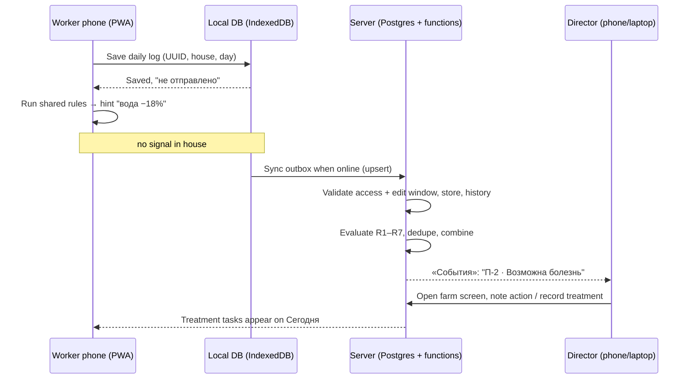
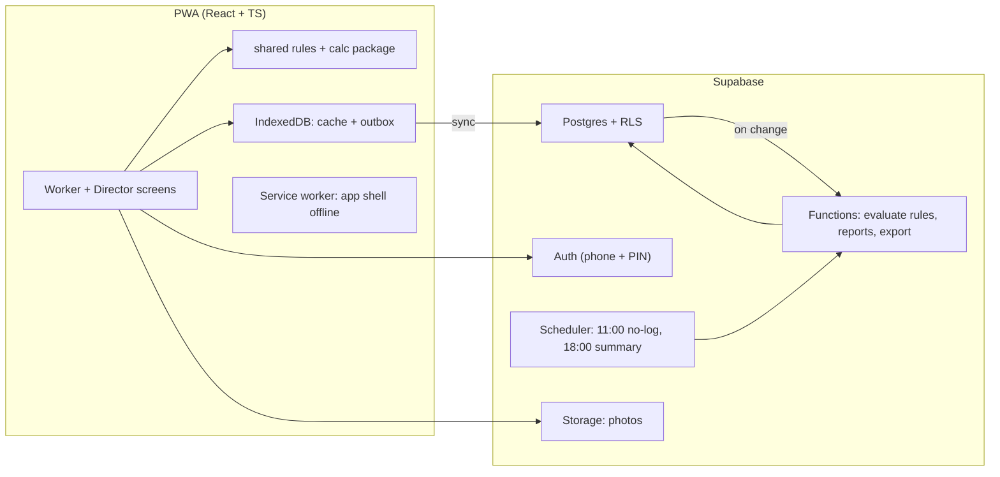
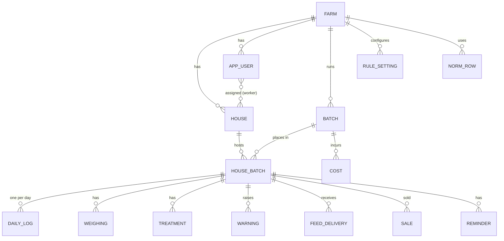

# Technical Spec: Broiler Farm App (MVP)

**Date:** 2026-11-25 · **Author:** Jarvis · **Status:** Draft · **Mode:** greenfield
**Inputs:** `BLUEPRINT.md` (v2.1: workers run all operations, director sees everything; see its §0.2) · `design/` (worker phone, director phone, director laptop) · `knowledge/` (Arbor Acres Handbook 2015 + Russian broiler guide)

---

## 1. Summary
An offline-capable web app (installable PWA) for one broiler farm with 4 houses and ~68,000 birds per batch.
- **House workers** record each house's day on their own Android phones in under 2 minutes, with or without signal.
- **Workers** (all equal) record every operation of their own houses — placement, feed deliveries, health, weighing, catch and handover — but never see money.
- **The director** (owner) sees everything the same day, including money, gets norm-based warnings and notifications, can correct anything, and enters prices, costs and payments. Nothing waits for approval.
- Each batch closes with production results **and profit**.

**No AI/LLM is needed.** Every behaviour is deterministic: norm tables, threshold rules and arithmetic. Adding an LLM would add cost and unpredictability for no gain.

## 2. Problem & Goal
- **Problem:**
  - Daily house data lives in paper notebooks and phone calls, so problems (death spikes, water drops) surface 1–3 days late.
  - Feed is not tracked per house, so FCR and profit per batch are unknown or weeks late.
  - Withdrawal periods are tracked from memory.
- **Users:** Worker (2–4 people, Android phone, inside the houses); Director (1 person, phone + laptop).
- **Value:** +1% mortality ≈ 680 birds per batch; +0.1 FCR ≈ 17 t of feed per batch (blueprint estimates ⚠️). Seeing both the same day is the product.
- **Success metrics (measurable):**
  - **M1:** ≥ 95% of house-days have a daily log over a full pilot batch. This is the leading signal, readable in week 1.
  - **M2:** median time from opening the daily log to saving it < 2 min (app telemetry).
  - **M3:** the batch report matches the director's manual calculation of survival, FCR and profit within 1%.
  - **M4 (lagging):** EPEF ↑ vs baseline (~280 ⚠️) over 2–3 batches.

## 4. Scope
- **Hypothesis the MVP tests:** *workers will log every house every day on their own phones, and the director will act on same-day warnings.* If logging stops, nothing else matters; that is why Phase 1 is the offline daily log on real phones.
- **In scope (MVP):**
  - two roles
  - houses, workers and settings
  - batch + placement
  - offline daily log
  - weighing (average, CV%)
  - 8 warning rules + the combined "Возможна болезнь" warning
  - age reminders
  - treatments with a withdrawal block
  - feed deliveries
  - costs
  - catch plan
  - sales with paid/owed
  - batch report (production + money + reconciliation)
  - PDF/XLSX export
  - in-app notifications for the director («События» feed + badge); no Telegram
  - Russian UI
- **Out of scope (explicit):**
  - vet and storekeeper roles
  - approvals / four-eyes
  - warehouse, payroll, 1C or any accounting integration
  - sensor or climate-controller import
  - partial catches (thinning)
  - multi-site and staggered batches
  - batch-to-batch comparison dashboards (v1)
  - cleanout checklist (v1)
  - buyer debt reminders (v1)
  - Kyrgyz UI (v1, but i18n-ready from day 1)
  - iOS-specific testing
  - native app store builds

## 5. Requirements

### 5.1 Functional
Roles: **W** = worker (only assigned houses; all operations; **no money**), **H** = director (everything, incl. money; role code `head` in the database). Nothing requires approval: H is notified instead. Times use the farm timezone (assumed Asia/Bishkek ⚠️).

| ID | Requirement | Pri | Acceptance criteria |
|---|---|---|---|
| FR-1 | H creates houses (name, floor m², water meter yes/no, drinker and feeder type) and assigns workers to houses | Must | AC-1.1 Given H in Settings, When H adds "П-5" with 1000 m², Then it appears in the farm list and in batch placement. AC-1.2 Given W assigned to П-1, П-2, When W opens the app, Then only П-1 and П-2 are visible. |
| FR-2 | H invites a worker by phone number; the worker signs in with phone + 6-digit PIN; the session persists for ≥ 30 days without signal | Must | AC-2.1 Given a valid invite, When W sets a PIN, Then W lands on Сегодня. AC-2.2 Given W signed in yesterday and offline today, When W opens the app, Then it opens without re-login. AC-2.3 5 wrong PINs → 15-min lockout ⚠️ proposal. |
| FR-3 | W (or H) records **placement** for their house: date, hatchery, waybill count, transport deaths, placed, parent-flock age, day-0 weight, cloacal t, crop fill 2–48 h. The first placement opens the batch if none is open. H enters the chick price | Must | AC-3.1 Placed = waybill − transport deaths (editable). AC-3.2 When H sets the chick price, a Cost "Цыплята" = waybill × price is created; W never sees it. AC-3.3 Day of age is computed per house from **its own** placement date. AC-3.4 Only one open batch at a time. |
| FR-4 | W records a **daily log** per house: deaths, culls (+reason), feed (kg or bags × bag kg), water meter reading, t min/max, RH, optional note/photo. One log per house per **production day** (08:00→08:00, setting) | Must | AC-4.1 Given no signal, When W saves, Then the log is stored on the device and shown as "не отправлено". AC-4.2 When the signal returns and the app is open, Then the log syncs within 60 s without user action ⚠️. AC-4.3 A 2nd save for the same house+day updates the existing log, never creates a duplicate. AC-4.4 Water L = (reading − previous reading) × 1000; a reading lower than the previous one requires "новый счётчик" confirmation. |
| FR-5 | Plausibility check before saving: a value > 5× the 7-day average, or outside physical limits (t < 0 or > 45 °C, RH > 100), asks "Это верно?" | Must | AC-5.1 Deaths 90 with a 7-day average of 11 → confirmation dialog; "Исправить" returns to the form with values kept. AC-5.2 Nothing is silently blocked. |
| FR-6 | Edit window: W can edit their logs ≤ 48 h after creation; H can edit any log, an edit > 48 h requires a reason. Every edit after first sync is stored in history (who, when, old→new, reason) | Must | AC-6.1 W edits a 49-h-old log → refused by the server with "только руководитель". AC-6.2 Edit history shows old and new values. |
| FR-7 | On save the app shows the norm check on the device (works offline): deaths %, water:feed vs norm, working t vs target, RH | Must | AC-7.1 Same inputs → same result offline and on the server (shared rule code, see §7). |
| FR-8 | **Weighing:** W or H enters individual weights (keypad) or group weighing (crate kg + count); the app shows n, average, SD, CV%, deviation vs the norm, and a sample target = max(100, 1% of live birds) | Must | AC-8.1 Weights 2550-mean / SD 250 → CV 9.8% (handbook example). AC-8.2 Group weighing shows the average only (no CV). AC-8.3 Weights outside ±15% of the mean are highlighted. |
| FR-9 | **Warnings:** the server evaluates 8 rules after each synced log/weighing and on schedule; thresholds editable by H (defaults below) | Must | see §5.4 rule table; AC-9.x per rule. |
| FR-10 | Deduplication: at most one warning per rule per house per production day; if ≥ 2 rules fire for one house on one day, they are shown as one **"Возможна болезнь"** critical warning that lists the triggers | Must | AC-10.1 Mortality spike + water drop on П-2 → one critical warning with both triggers, one entry in «События». |
| FR-11 | H notes an action on a warning (free text). A warning auto-closes after 24 h back within the norm; a critical one closes only by H | Must | AC-11.1 Note is visible on the farm screen and in the house history. |
| FR-12 | **Health:** W (or H) records vaccinations, treatments (product, dose, lot, start date, course days, withdrawal days) and post-mortem findings for their house. The app computes earliest slaughter = last dose date + withdrawal days + 1, creates daily dosing tasks, and **notifies H immediately**. H may add the medicine cost (finance) | Must | AC-12.1 Start 24.11, 5 days, withdrawal 7 → earliest slaughter 06.12. AC-12.2 W sees "Лечение, день N из 5" on Сегодня each day. |
| FR-13 | **Catch plan:** W (or H) sets the catch date/time per house; if it is earlier than any active treatment's earliest slaughter date it is **blocked**; W or H can override with a reason (stored in history) and **H is notified immediately** — no approval step | Must | AC-13.1 П-2 catch 04.12 with earliest 06.12 → red block with "Перенести на 06.12". AC-13.2 Override with reason saves, appears in the history and sends H a notification. |
| FR-14 | **Reminders** are generated from the placement date and catch date: day 1 crop fill; day 7 weigh + light change; ~10 starter→grower; 18 pellets; ~25 finisher; weekly weighing; catch −3 d 23 h light; −2 d no whole wheat; feed-off at catch − (8–12 h) | Should | AC-14.1 Moving the catch date regenerates the catch-relative reminders. AC-14.2 A reminder has a window (e.g. day 24–25); it becomes "просрочена" after the window. |
| FR-15 | **Feed deliveries:** W (or H) records date, feed type (старт/рост/финиш), house, tonnes, waybill photo; also the feed phase change. H adds the price per tonne (finance), which becomes a Cost "Корм" | Must | AC-15.1 Bin stock per house = deliveries − logged feed; days left = stock / 3-day average use. |
| FR-16 | **Costs (H only):** H adds costs by category (Газ и уголь, Электричество, Зарплата, Подстилка, Ветврач, Прочее) with amount, date, comment; chicks, feed and medicine costs come from the prices H sets on placements, deliveries and treatments | Must | AC-16.1 Total and per placed bird update immediately. AC-16.2 A deliveries list shows "нет цены" for deliveries W recorded that H hasn't priced yet. |
| FR-17 | **Handover and sale:** W (or H) records per house the handover: buyer, birds, kg, transport deaths, weight-slip photo, feed-off time. H adds the price per kg and payments (finance). The app computes the average weight, sum and amount owed | Must | AC-17.1 40 546 kg × 140 = 5 676 440; paid 4 000 000 → owed 1 676 440. AC-17.2 W sees birds, kg and average weight only. |
| FR-18 | **Batch report** (H sees all; W sees the production part for their houses, never money): survival, deaths %, culls %, average kg, ADG, FCR (final = (delivered − bin stock at close) / kg sold), adjusted FCR (only if \|target − actual\| ≤ 0.227 kg), EPEF, per-house table, revenue, costs by category, profit, per kg and per bird, owed, bird and feed reconciliation | Must | AC-18.1 Handbook examples reproduce: EPEF(42 d, 2.652 kg, 2.80%, 1.75) = 351; adjusted FCR(1.215, 1.350, 1.290) = 1.228. AC-18.2 Unexplained birds > 0.2% or feed > 1% → warning line in the report. |
| FR-19 | H closes the batch → the report is locked (read-only); H can reopen with a reason; versions are kept | Must | AC-19.1 Closed batch: all its logs, costs and sales are read-only for everyone. |
| FR-20 | Export the report to PDF and XLSX | Should | AC-20.1 The XLSX contains sheets: Summary, Houses, Costs, Sales, Daily logs. |
| FR-21 | **In-app notifications** to H (no Telegram, decided 27.11): the «События» feed and a badge on Ферма/События show immediately each critical warning, new treatment, catch override inside withdrawal and edit older than 48 h; «нет журнала» appears at 11:00 | Must | AC-21.1 A treatment saved by W appears in H's «События» within one sync. AC-21.2 The badge count drops when H opens «События». |
| FR-22 | Director screens work on phone (390 px) and laptop (≥ 1280 px) from one app; worker screens are phone-first | Must | AC-22.1 Every director screen in `design/` exists in both widths. |
| FR-23 | **Money is invisible to workers.** Prices, costs, sums, revenue, profit, payments and debts are stored in finance tables that RLS makes readable and writable by H only; worker-facing views and API responses contain no money fields | Must | AC-23.1 With a W token, selecting from any finance table returns 0 rows and inserting is refused. AC-23.2 No worker screen shows a currency amount. |

### 5.2 Non-functional
| Category | Requirement | How we check |
|---|---|---|
| Offline | Worker screens (Сегодня, Журнал, Взвешивание) work fully offline after the first sign-in; ≥ 14 days of unsent records are kept on the device ⚠️ proposal | Airplane-mode test on 3 real worker phones; kill the app and reboot the phone → records survive |
| Devices | Android 8+ with current Chrome; works on a low-end phone (2 GB RAM) ⚠️ to confirm against the workers' real phones | Test on the actual phones in Phase 1 |
| Performance | Daily log opens < 2 s on a low-end phone after the app is cached; the director farm screen loads < 3 s on 3G ⚠️ proposal | Lighthouse throttled + a real-device stopwatch |
| Scale | ~6 users, 4 houses, ~6 batches/year → < 10k daily logs over 5 years. No scaling work needed | — |
| Security | Server-side row-level access: W reads/writes only assigned houses' operational records (logs, feed deliveries, health, placement, weighing, catch, handover) and **no finance tables**; H everything. PIN lockout. HTTPS only | Automated tests with a W token attempting H actions → 403 |
| Data protection | Daily backups; retention ≥ 5 years for batch data ⚠️ confirm backup tier/price | Restore drill once before the pilot |
| Reliability | Sync is idempotent (client-generated UUIDs, upsert); a failed sync retries automatically when the app is next online; no record is ever deleted on sync error | Test: duplicate submit, flaky network, server 500 |
| Observability | Server errors logged with request id; a daily check that each house has a log (this is also FR-21); client sync errors reported when online | Error tracking dashboard (tool TBD) |
| Localisation | Russian UI; all strings in translation files (Kyrgyz in v1); numbers with comma decimals and thin-space thousands (`1 970,5`); currency сом ⚠️; dates DD.MM | UI review |
| Maintainability | Deployable by one engineer; schema migrations versioned; seed script for norms | README + CI |

### 5.3 Edge cases → expected behaviour
- **Empty states:**
  - no open batch → the worker sees "В птичнике нет партии" plus the next placement date
  - a house with no logs → dashes in the table, never zeros
- **No log for a day:** shown as a gap in charts and "нет данных" in reports; the system never fills in numbers.
- **Water meter:**
  - a reading below the previous one → "Новый счётчик?" → if yes, it starts a new series, and that day's water is entered manually
  - a house without a meter (setting) → water fields hidden, the water rules disabled for that house
- **Duplicate submit / double tap:** the client UUID plus the unique (house_batch, production_day) key → one log.
- **Two people edit the same log offline:** last write wins by server receive time; the earlier version is kept in history; H is notified.
- **The worker's phone dies mid-entry:** a draft is autosaved locally on every field change.
- **Worker reassigned:** they lose access to old houses for new entries; their past logs remain attributed to them.
- **Batch closed while a worker has unsent logs:** sync is refused with "партия закрыта — сообщите руководителю"; the record stays on the phone and H sees it in "не принятые записи".
- **Catch date moved after reminders were generated:** the catch-relative reminders are regenerated; done ones are kept.
- **A treatment added after the catch is planned:** re-check → the catch plan is blocked if it is now inside the withdrawal period.
- **Time:**
  - the production day boundary is 08:00 local
  - the server stores UTC and computes in the farm timezone
  - a phone with a wrong clock → the server uses its own receive time for the edit window, and the client time only for the production day; a > 2 h difference warns the user

### 5.4 Warning rules (defaults from Arbor Acres; editable)
| # | Rule | Fires when | Severity |
|---|---|---|---|
| R1 | Week-1 mortality | cumulative (deaths+culls)/placed by day 7 > 0.7% (critical > 1%) | warn/crit |
| R2 | Mortality spike | today's deaths+culls > 2 × 3-day average **and** > 0.05% of live birds | crit |
| R3 | Water change | daily litres ±15% vs previous day (from day 3) | warn |
| R4 | Water:feed | outside 1.6–1.8, norm × (1 + 0.065 × (t − 21)) when working t > 21 °C | warn |
| R5 | Temperature | working t = min + ⅔(max − min) outside AA Table 2 target for the age ± 1.5 °C | warn |
| R6 | Weight / uniformity | weight < −5% of norm (needs AA Performance Objectives) **or** CV% > 10 | warn |
| R7 | Feed bin | days left < 2 (critical < 1) | warn/crit |
| R8 | No log | no log for the production day by 11:00 | warn |
| R* | Combined | ≥ 2 of R1–R7 for one house on one day → "Возможна болезнь — позвоните ветврачу" | crit |

## 6. Critical user flow
The spine of the product: a worker's offline log becomes the director's same-day warning.

## 7. Architecture

**Key decisions**
1. **One codebase, installable PWA.** Worker phone, director phone and director laptop are the same React app with role-based routes and responsive layouts. No Play Store release cycle; updates are instant. The worker installs it to the home screen.
2. **Offline-first for worker screens only.** Local IndexedDB holds the current batch's houses, the last 14 days of logs (for averages and the plausibility check), norm tables, rules and reminders. Writes go to an **outbox** and sync by upsert keyed on client UUIDs. The director screens are online-first with a cached last view ("обновлено N мин назад").
3. **Rules and calculations live in one TypeScript package** (`@farm/rules`), used by the PWA (instant offline hint) and by the server functions (authoritative warnings, reports). This is the main reason for TypeScript on the server instead of FastAPI: two implementations of FCR/EPEF/rules would drift.
4. **The server is the source of truth.** The device hint is advisory; the warnings, history and reports come from the server.
5. **Reports are computed on demand** from the raw records (SQL views + a function). Nothing derived is stored except the locked snapshot taken when a batch is closed.
6. **No AI.** Everything is rules and arithmetic; see §1.

## 8. Tech stack
| Component | Choice | Alternatives | Why | Verify? |
|---|---|---|---|---|
| Client | **PWA: React + TypeScript + Vite** | Flutter (Android + web); React Native/Expo + separate web | One codebase for all 3 surfaces, no store, smallest team cost; offline need is small (a few records/day) | **Spike T-02:** offline + install + storage persistence on the workers' real Android phones. If it fails → Flutter |
| Offline storage | **IndexedDB via Dexie** + own outbox | RxDB, PowerSync / ElectricSQL sync engines | Data is tiny and conflicts are rare; a hand-rolled outbox is easier to reason about than a sync engine | Check Dexie version; request `navigator.storage.persist()` and test eviction |
| App shell offline | **Service worker (Workbox / vite-plugin-pwa)** | hand-written SW | Proven precaching | versions |
| Backend + DB | **Supabase: Postgres, Auth, Row Level Security, Storage** | FastAPI + Postgres (house default); Firebase | Matches the house stack (Supabase); RLS gives role access without a custom API layer; managed backups | Confirm plan, region (closest to KG), backup retention and price |
| Server logic | **Supabase Edge Functions (TypeScript)** + DB triggers/webhooks | FastAPI service on a VPS | Runs the shared TS rules package (decision 3). *Deviation from the FastAPI house default, justified by sharing rule code with the offline client* | Confirm Edge Function limits; whether importing a shared npm package works in that runtime **(?)** |
| Scheduler | **pg_cron** (or Supabase scheduled functions) | external cron | 11:00 no-log check, 18:00 summary, warning auto-close | Confirm availability on the chosen plan **(?)** |
| Auth | Supabase Auth, **phone + 6-digit PIN mapped to an internal email/password account** | SMS OTP | No SMS provider, cost or coverage risk in KG; the director creates accounts | Confirm password min-length settings allow a 6-digit PIN; add lockout logic |
| UI | **Tailwind CSS** + own components from the design tokens | MUI, shadcn/ui | The design is custom and dense; tokens map 1:1 | — |
| Charts | **Recharts** or plain SVG | Chart.js, ECharts | 4 simple charts; plain SVG is acceptable | — |
| i18n | **i18next** | FormatJS | Russian now, Kyrgyz v1 | — |
| Export | **XLSX: SheetJS** in a function or client; **PDF: print stylesheet** (browser "Save as PDF") | server PDF rendering | Simplest reliable path for a 1-page report | Check the SheetJS license for the chosen distribution |
| Notifications | **In-app «События» feed + badge** | Telegram bot, Web Push | Decided 27.11: no Telegram; everything stays inside the app | — |
| Hosting (PWA) | Static hosting (Cloudflare Pages / Netlify / Vercel) | Supabase Storage | Free tier is enough; HTTPS | — |
| Tests | Vitest (rules, calc), Playwright (critical flows, offline mode) | Jest, Cypress | Fast; Playwright can emulate offline | — |
| Errors | Sentry (or similar) | none | Know about sync failures before the director does | Pricing/free tier |

## 9. Data & integrations

**Core fields:**
- **house**: name, area_m2, has_water_meter, drinker_type, feeder_type
- **app_user**: role (`head` = director | `worker`), phone, display_name, pin_lock_until
- **batch**: name, breed, status (`open` | `catching` | `closed`), chick_price, closed_snapshot (jsonb)
- **house_batch**: placed_at, waybill_count, transport_dead, placed, parent_age_weeks, day0_weight_g, cloacal_t, crop_fill_24h, catch_at, catch_override_reason
- **daily_log**:
  - id (client UUID), house_batch_id, production_day (date)
  - deaths, culls, cull_reason, feed_kg, water_meter, water_l, new_meter, t_min, t_max, rh, note, photo_path
  - created_by, created_at, updated_at
  - **unique** (house_batch_id, production_day)
- **weighing**: id, house_batch_id, date, method (`individual` | `group`), samples (numeric[] or crate rows), n, mean_g, sd_g, cv
- **treatment**: kind (`vaccination` | `treatment` | `post_mortem`), product, dose, lot, start_date, course_days, withdrawal_days, findings, earliest_slaughter (computed), created_by
- **warning**:
  - rule_code, house_batch_id, production_day, severity, value, norm, triggers[], status (`open` | `noted` | `closed`), note, noted_at
  - **unique** (rule_code, house_batch_id, production_day)
- **feed_delivery** (operational): date, feed_type, house_batch_id, tonnes, photo_path, created_by
- **handover** (operational): house_batch_id, catch_at, feed_off_at, buyer, birds, kg, transport_dead, photo_path, created_by
- **Finance tables — RLS: director only (FR-23):**
  - **price**: kind (`chick` | `feed` | `medicine` | `sale`), ref_id (placement / feed_delivery / treatment / handover), unit_price, currency
  - **cost**: batch_id, category, amount, date, comment, source (`manual` | `chicks` | `feed` | `medicine`), source_id
  - **payment**: handover_id, buyer, amount, paid_at, comment
- **reminder**: house_batch_id, code, window_start, window_end, status, done_by, done_at
- **rule_setting**: rule_code, params (jsonb), enabled
- **norm_row**: table (`temp_by_age` | `rh_adjust` | `weight_by_age` | `feed_by_age`), sex, age_day, values (jsonb)
- **edit_history**: entity, entity_id, user_id, at, field, old, new, reason

**Integrations:**
- None outbound for notifications (decided: no Telegram).
- No other external systems in the MVP.

**Seed data:** AA Table 2 (temperature by age), Table 3 (RH adjustment), crop-fill targets, the minimum-ventilation table (v1 helper), reminder templates. **Weight/feed by age requires the AA Performance Objectives booklet**, which we don't have yet; until it arrives R6 runs on CV% only.

## 10. Quality / test strategy (no AI → no eval set; a calculation golden set instead)
- **Golden calculations** from the handbook, as unit tests on `@farm/rules`:
  - EPEF = 351 and 346
  - CV% = 9.80
  - FCR = 1.169
  - adjusted FCR = 1.228
  - working temperature = 24 °C (16/28)
  - minimum ventilation example = 35% / 105 s
  - plus the report figures in the designs (batch 05/2026: EPEF 296, profit 2 711 800)
- **Rule tests:** for each of R1–R8 and R*: fires / doesn't fire at the threshold boundary (exactly the threshold, ±1 unit).
- **Offline E2E (Playwright):** log offline → reload → reconnect → exactly one server row; duplicate submit; reject after 48 h for W.
- **Pilot data check (M3):** the director computes one batch by hand; the report must match within 1%.

## 11. Implementation plan
*Sizes are relative guides, not commitments. Assumes 1–2 developers.*

- **Phase 0 — Adoption test (not dev work) · S:** a 2-week Google-Form (or paper-copy) daily log in one house, per the blueprint.
  - *Done when:* ≥ 12 of 14 days logged. If this fails, fix adoption before building.
- **Phase 1 — Offline daily log on real phones (the main risk) · L:**
  - project setup, Supabase schema + RLS
  - auth (phone + PIN), houses and workers
  - a seeded batch, the worker's Сегодня + Журнал with offline outbox and sync
  - plausibility check
  - a basic director farm table
  - *Done when:* 2 workers log their houses for 7 consecutive days on **their own phones inside the houses**, with 0 lost or duplicated logs (server rows = device records), and the median time to log < 2 min.
- **Phase 2 — Norms, warnings, weighing · M:**
  - the `@farm/rules` package with golden tests
  - norm seed, R1–R8 + combined, warning UI with notes, in-app notifications
  - weighing, reminders, the director house screen with charts
  - *Done when:* a replay of 23 days of the designs' example data produces exactly the warnings shown in `design/HFarm` (1 critical on П-2, 4 warnings), and each appears in «События» after one sync.
- **Phase 3 — Batch & money · M:**
  - batch open + placement
  - treatments + withdrawal block, feed deliveries, costs
  - catch plan, sales, batch report, close/lock, PDF/XLSX, settings
  - *Done when:* entering the 05/2026 example batch reproduces the report in `design/HReport` (EPEF 296, FCR 1.89, profit 2 711 800, reconciliation 52 birds / 2.6 t), and a catch inside withdrawal is blocked.
- **Phase 4 — Pilot batch & hardening · M:**
  - all 4 houses for one full batch
  - backups + restore drill, error tracking, fixes from weekly reviews
  - *Done when:* M1 ≥ 95% and M3 within 1% for the pilot batch.

Dependencies: 0 → 1 → 2 → 3 → 4. Phase 3's UI work (placement, costs, sales forms) can start in parallel with Phase 2 once T-04 (schema) is done.

## 12. Tickets

| ID | Task | Ph | Size | Depends | Req |
|---|---|---|---|---|---|
| T-01 | Repo, Vite+React+TS PWA skeleton, Tailwind with design tokens, i18next (ru), CI (lint, tests), static hosting | 1 | S | — | FR-22 |
| T-02 | **Spike:** offline install + IndexedDB persistence + sync on the workers' actual phones (airplane mode, reboot, storage eviction); write a decision note: PWA ok / switch to Flutter | 1 | S | T-01 | NFR Offline |
| T-03 | Supabase project, env/secrets, migrations tooling | 1 | S | — | NFR Maint. |
| T-04 | Schema v1: farm, house, app_user, batch, house_batch, daily_log, edit_history + unique keys | 1 | M | T-03 | FR-1,3,4,6 |
| T-05 | RLS policies: worker = assigned houses, logs/weighings only; director = all; tests with both tokens | 1 | M | T-04 | NFR Security |
| T-06 | Auth: director invites by phone; worker sets a 6-digit PIN; long session; lockout after 5 tries | 1 | M | T-04 | FR-2 |
| T-07 | Settings (minimal): houses CRUD, assign workers | 1 | S | T-05 | FR-1 |
| T-08 | Local DB (Dexie): cache of houses/batch/last-14-days logs; outbox with client UUIDs; draft autosave | 1 | M | T-02, T-04 | FR-4 |
| T-09 | Sync engine: upsert outbox on online/app-open, retry, "не отправлено" counter, queue screen, server error mapping | 1 | M | T-08 | FR-4, NFR Reliab. |
| T-10 | Worker Сегодня screen (house switcher, age ruler, tasks placeholder, yesterday tiles) | 1 | M | T-08 | FR-4 |
| T-11 | Worker Журнал screen: steppers, numeric inputs, bags→kg, water meter delta, new-meter flow, plausibility dialog | 1 | M | T-10 | FR-4, FR-5 |
| T-12 | Server: production-day computation, 48 h edit-window check, edit history trigger | 1 | M | T-04 | FR-4, FR-6 |
| T-13 | Director farm table v0 (4 houses, today's log values, log status) — phone + laptop | 1 | S | T-09 | FR-22 |
| T-14 | Offline E2E tests (Playwright): offline save → reconnect → one row; double submit; 49-h edit rejected | 1 | S | T-09, T-12 | NFR Reliab. |
| T-15 | `@farm/rules` package: calculations (live birds, mortality, water:feed, working t, CV, FCR, EPEF, adjusted FCR, density, days left) + golden tests | 2 | M | T-01 | FR-7, FR-18 |
| T-16 | Norm tables schema + seed (AA Tables 2, 3, crop fill); placeholder weight norms flagged | 2 | S | T-04 | FR-9 |
| T-17 | Rules R1–R8 + combined R* in `@farm/rules` with boundary tests | 2 | M | T-15, T-16 | FR-9, FR-10 |
| T-18 | Server function: evaluate rules on log/weighing change; dedupe; upsert warnings | 2 | M | T-17 | FR-9, FR-10 |
| T-19 | Scheduler: 11:00 no-log (R8), 18:00 summary, 24 h auto-close | 2 | S | T-18 | FR-11, FR-21 |
| T-20 | In-app notifications: «События» badge (unseen count), mark seen | 2 | S | T-18 | FR-21 |
| T-21 | On-device hint after save (shared rules, offline) | 2 | S | T-11, T-17 | FR-7 |
| T-22 | Director: warnings panel with causes (AA Appendix 5 text), note action — phone + laptop | 2 | M | T-18 | FR-11 |
| T-23 | Weighing screen: keypad, individual/group, live n/mean/SD/CV, sample target, outliers; sync | 2 | M | T-09, T-15 | FR-8 |
| T-24 | Reminders: templates, generation from placement/catch, worker task list, done/overdue | 2 | M | T-10 | FR-14 |
| T-25 | House screen (director: all; worker: own house, no money): 4 charts vs norm, weight table, last logs, events — phone + laptop | 2 | M | T-15, T-22 | FR-22 |
| T-26 | Schema v2: weighing, treatment, warning, feed_delivery, cost, sale, reminder, rule_setting, norm_row + RLS | 2 | S | T-04 | — |
| T-27 | Placement form for W and H (opens the batch on first placement), one-open-batch rule; H: chick price → cost | 3 | M | T-26 | FR-3 |
| T-28 | Health for W and H: vaccination, treatment, post-mortem; earliest slaughter, dosing tasks, immediate H notification; H: medicine cost | 3 | M | T-24, T-26, T-20 | FR-12, FR-21 |
| T-29 | Feed deliveries for W and H (tonnes, photo, phase change) + bin stock/days left; H: price per tonne, "нет цены" list | 3 | M | T-26 | FR-15, FR-16 |
| T-30 | Costs: categories, add sheet, totals, per bird | 3 | S | T-26 | FR-16 |
| T-31 | Catch plan for W and H: dates, withdrawal block + override with reason (H notified), feed-off time, regenerate reminders | 3 | M | T-28, T-24 | FR-13 |
| T-32 | Handover for W and H (buyer, birds, kg, slip photo); H: price per kg, payments, owed | 3 | M | T-26 | FR-17 |
| T-32b | Finance separation: price/cost/payment tables with director-only RLS; DB tests that a worker token sees no money; worker screens audited for amounts | 3 | S | T-26 | FR-23 |
| T-33 | Batch report: SQL views + function, per house, money, reconciliation warnings — phone + laptop | 3 | L | T-15, T-29, T-30, T-32 | FR-18 |
| T-34 | Close / reopen batch, locked snapshot, read-only enforcement (RLS + UI) | 3 | M | T-33 | FR-19 |
| T-35 | Export: XLSX (5 sheets) + PDF print stylesheet | 3 | S | T-33 | FR-20 |
| T-36 | Settings full: thresholds editor, production-day hour, currency, prices, notifications | 3 | S | T-17 | FR-9 |
| T-37 | Empty/error/offline/no-permission states on every screen (per design `WStates`) | 3 | M | T-13…T-35 | §5.3 |
| T-38 | Backups confirmed + restore drill; error tracking; README + runbook | 4 | S | T-34 | NFR Data, Maint. |
| T-39 | Pilot support: weekly review, fix list, telemetry for M1/M2 | 4 | M | all | M1–M3 |

**Parallel tracks:**
- **Phase 1:** T-01/T-03 in parallel, then T-02 before T-08.
- **Phase 2:** T-15–T-17 (rules) runs in parallel with T-23/T-24 (UI).
- **Phase 3:** T-29, T-30 and T-32 are independent.

**Ticket bodies for the non-obvious ones**

#### [T-02] Spike: PWA offline on the workers' real phones
**Phase:** 1 · **Size:** S · **Depends on:** T-01 · **Requirements:** NFR Offline, FR-4
**What:** a minimal PWA that saves a form to IndexedDB, survives an app kill and a phone reboot, and syncs when back online; installed from the browser on each worker's actual phone.
**Done when:**
- On every pilot phone: install works; 20 records saved in airplane mode survive a reboot; all 20 arrive exactly once after reconnecting.
- `navigator.storage.persist()` result is recorded per phone.
- A decision note: **continue with PWA**, or **switch the client to Flutter**, with the reason.

**Not included:** UI polish.

#### [T-09] Sync engine
**Phase:** 1 · **Size:** M · **Depends on:** T-08 · **Requirements:** FR-4, NFR Reliability
**What:** push the outbox in order; upsert by id; on 4xx (closed batch, edit window) mark the record "не принято" with a reason, keep it locally and show it to the user; on network/5xx retry later; pull changes since the last sync for the cached houses.
**Done when:**
- Offline → reconnect leaves exactly one server row per record.
- A 49-h edit by a worker becomes "не принято" with a readable message.
- The pending counter is accurate after an app restart.
- Playwright tests (T-14) pass.

#### [T-33] Batch report
**Phase:** 3 · **Size:** L · **Depends on:** T-15, T-29, T-30, T-32 · **Requirements:** FR-18
**What:**
- server-side aggregation (SQL views + a function using `@farm/rules`) for production, money and reconciliation
- age for EPEF = birds-weighted average age at catch
- final FCR = (Σ deliveries − bin stock at close) / Σ kg sold
- adjusted FCR shown only within ±0.227 kg of the target
- the report screen for phone + laptop

**Done when:**
- The handbook golden tests pass.
- Entering the 05/2026 example data reproduces the `design/HReport` figures exactly.
- Unexplained birds > 0.2% / feed > 1% show the warning line.

## 13. Risks & open questions
**Assumptions (stated instead of an answer):**
- One farm, one site, one open batch at a time, all houses placed within 1–2 days.
- Farm timezone Asia/Bishkek; currency сом; production day 08:00→08:00 (open in the blueprint).
- Workers' phones run Android 8+ with Chrome and have mobile data at least near the office.

**To verify before or while building:**
- PWA offline/persistence on the actual worker phones (T-02). This decides PWA vs Flutter.
- Supabase plan: region, backup retention, pg_cron / scheduled functions availability, Edge Function runtime support for the shared package, price.
- Supabase Auth: whether a 6-digit numeric password is allowed, or the PIN needs padding/derivation.
- Current library versions (React, Vite, Dexie, Workbox, SheetJS licence) at project start.
- The **AA Performance Objectives** booklet for weight/feed by age (blocks R6's weight part and the "норма" columns).

**Open questions for the director:**
1. Does every house have a water meter?
2. How does feed reach each house: weighed, bags, or bulk into bins?
3. Production day: 08:00 → 08:00, or calendar date?
4. Who pays for and owns the hosting account?
5. Buyers: is a price per kg always known at the catch, or settled later?

**Risks → mitigation / early signal:**

| Risk | Mitigation | Early signal |
|---|---|---|
| Workers stop logging | Phase 0 test; 2-minute form; the director's "not in the app = not done" rule | M1 < 90% in week 1 |
| Browser clears offline data on low-end phones | persistent-storage request; an unsent-records counter; sync whenever opened | T-02 result; "не отправлено" counts growing |
| Rule code drifts between phone and server | a single `@farm/rules` package, golden tests in CI | any mismatch in T-21 vs T-18 tests |
| Placeholder weight norms mislead | label "норма*"; R6 uses CV% only until AA Performance Objectives are loaded | — |
| Wrong data entry ruins reports | plausibility check, edit history, reconciliation lines in the report | unexplained feed > 1% |
| Director misses a critical event | badge on Ферма/События; «нет журнала» at 11:00 | events unseen after 2 h |
